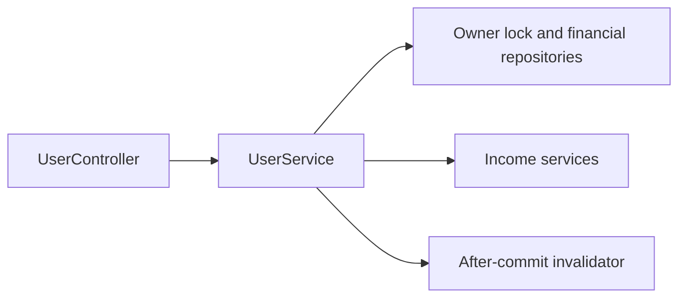
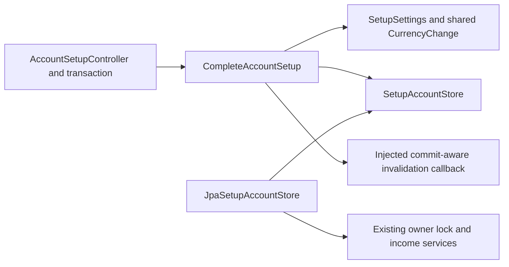

# Account setup completion

Increment 6 covers authenticated `PATCH /api/users/me/setup`. The existing request validation and response records remain at the HTTP boundary. The frontend continues to send the same request and persist the returned setup state through its existing session path.

## Dependencies

Before

After

The use case checks completion while holding the owner lock. A completed request returns the saved profile without financial validation, mutation or eviction. Bean validation still runs before the controller. For a first completion, the policy checks finite non-negative income, normalizes and validates the ISO code, and skips the financial-data reads when the currency matches. The existing standalone currency route uses the same eligibility decision and keeps its original input validation, repository checks, lock and cache calls.

For a change, the adapter checks transactions, budgets, then income configuration, retaining short-circuit order. The use case changes the managed currency and then selects the UTC month once. The existing income upsert reacquires the same owner lock in the same transaction, where it inserts or updates that month's baseline. The managed account adapter then sets the setup flag. JPA dirty checking persists it. The existing invalidator registers both cache evictions after commit. The profile is assembled inside the transaction using the same month. V34 and existing session validation stay in place.

## Verification and rollback

The PostgreSQL test observes the second request waiting in `pg_blocking_pids` while the first request holds the owner lock. The two sessions submit different currencies and values. The second returns the first committed result, and only one baseline exists. The integration test context uses a three-connection pool for two requests and the observer.

The Redis test verifies both regions survive a rollback, the row and baseline roll back, and a successful commit evicts only the owner's keys. A completed retry leaves new entries in place. A controlled timeout on a dedicated Redis instance exercises successful database commit during the outage and normal eviction after recovery. Pure policy tests pin UTC rollover, income validation order and retry behavior.

Revert the increment commits together to roll back. No data conversion is required. The next bounded candidate is the standalone monthly-income update. Characterize its lock re-entry, baseline carry-forward, write validation and after-commit eviction before selecting a boundary.

PostgreSQL statement logs recorded 11 setup statements in the winning change-of-currency request before and after, including two owner-lock reads and three writes. The retry issued three statements, including one lock and zero writes. Counts exclude JWT session lookup, test observer queries and transaction control. They describe the measured fixture, not all input branches.

The registry marks only the account setup command complete. The shared domain entry records the currency eligibility rule without declaring a second workflow migrated. The [hosted architecture check](https://github.com/Jatti045/fintech-platform/actions/runs/44964122809) passed before this completion entry was updated.
