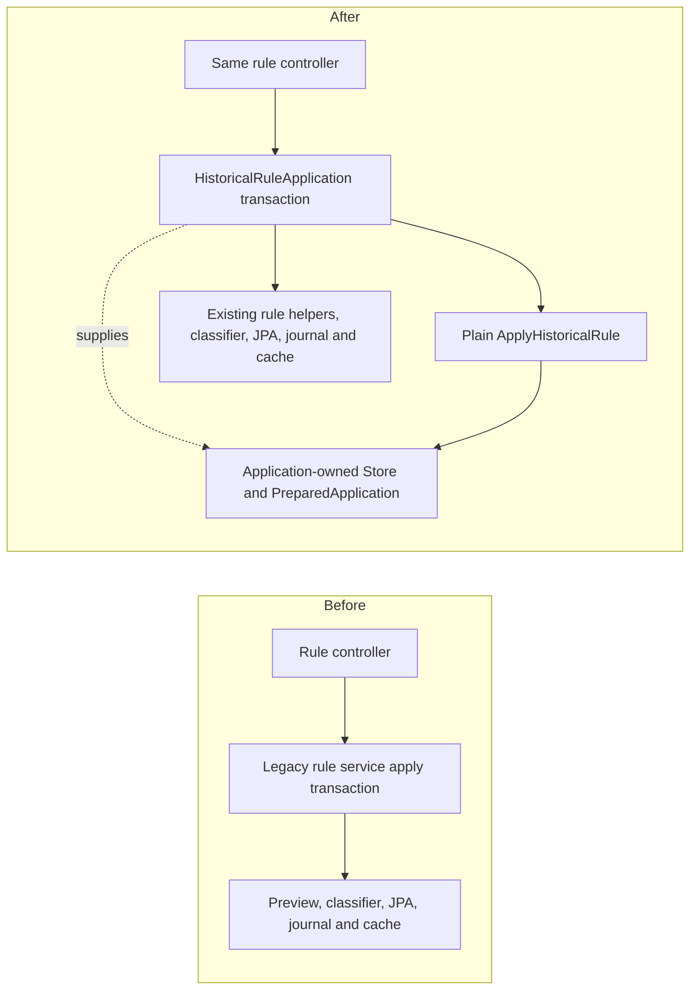

# Increment 9D1 · Historical categorization apply

The migrated operation is `POST /api/categorization-rules/{id}/apply`. It keeps the existing request, response, owner lock, preview token, rule snapshot, budget recalculation and persisted undo journal.

`ApplyHistoricalRule` compares supplied and prepared tokens, filters the ordered winning matches, counts changed rows, saves the journal even for an empty result, and requests after-commit eviction only for nonempty journals. Its `Store` prepares the request under the owner lock. Its per-request `PreparedApplication` exposes only plain preview facts and retains managed entities and journal entries outside the application layer.

The existing controller calls one Spring-managed transaction using the original default propagation and isolation. The command resolves the authenticated ID, locks the owner, resolves the owned target and calls the same preview calculation. The preview endpoint keeps its own unchanged read-only repeatable-read boundary. Apply's adapter re-reads winning rows by owner and checks their current disabled flag before snapshot and classification. It uses the existing state and fingerprint methods for journal inclusion, keeping serializer configuration, journal types and byte order intact. UUID generation and the application batch's JVM timestamp remain outer-layer details. The existing classifier still performs its reentrant lock, budget updates, flush and refresh. Calling only the existing helpers from the new boundary avoids any legacy service back-reference.

## Compatibility evidence

- The fixed PostgreSQL HTTP fixture verifies exact preview JSON, tokens and committed-format journal bytes against original output, including after-fingerprints. A successful changed apply invalidates the old token. A zero-match token can be submitted repeatedly and creates distinct UUID batches with exactly `{"changes":[]}`. The fixture also stores the original-writer journal bytes in a separate batch, calls guarded undo, and verifies the restored provenance and repeat result. Other tests cover losing rules, disabled rows, unchanged snapshots, protected overrides, and conflict cases for later edits, removed transactions and original budgets that were renamed or removed.
- The PostgreSQL lock test observes the apply transaction blocked by the owner-lock holder. The holder changes a transaction and commits. Apply then recomputes history, rejects the pre-write token with HTTP 409, and leaves no batch.
- The Redis tests cover rollback of classification and budget creation, unchanged cache before commit, eviction after commit, owner isolation, unchanged cache on no-op, and successful committed changes during Redis timeout followed by eviction after recovery.

| PostgreSQL fixture | Original statements | Migrated statements |
|---|---:|---:|
| Empty preview and token replay | 27 | 27 |
| Golden HTTP, apply and stale replay | 83 | 83 |
| Golden HTTP with original journal undo | 107 | 107 |
| Live effective time and historical preview | 57 | 57 |
| Owned, older and foreign budget anchors | 34 | 34 |
| Preview at 500 and 501 matches | 516 | 516 |
| Preview, apply and undo | 40 | 40 |

Statement text and order matched across both golden replay variants and the other five fixtures. Counts include fixture work and exclude transaction-control statements, bound values and prepared-statement handles. No latency comparison was run.

Seven obsolete legacy dependencies from the removed apply method were deleted. Categorization remains partial. The next proposed increment isolates guarded undo while retaining its validation-before-restore order, original-budget checks, byte-compatible history reader and existing unprovenanced-category behavior. A rollback of this increment can revert its commits without changing the schema or rewriting stored journals.
