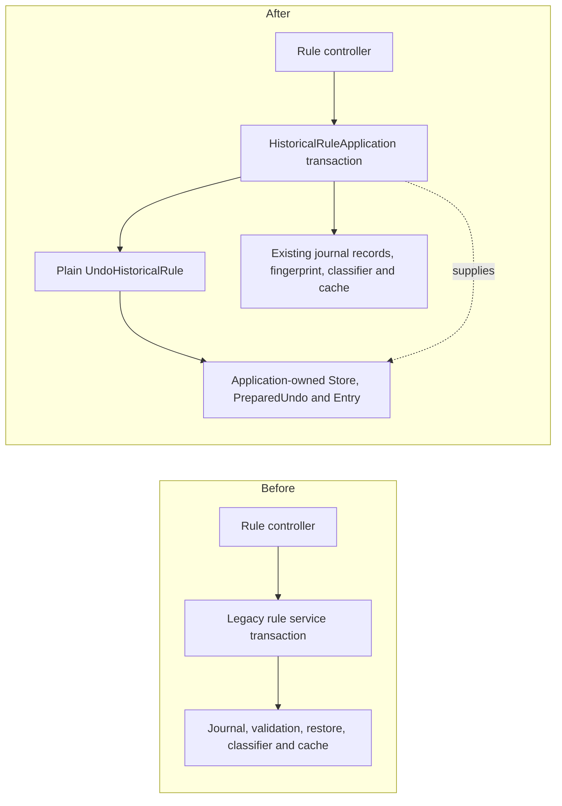

# Increment 9D2 · Guarded historical categorization undo

The migrated endpoint is `POST /api/categorization-rules/applications/{id}/undo`.

`UndoHistoricalRule` loads prepared undo under the owner lock. It short-circuits before reading the journal when the application is already undone. The first pass validates every entry in journal order. The second restores entries in the same order. The use case marks the batch undone only after both passes succeed and requests eviction only for nonempty journals.

The existing historical application infrastructure owns the transactional undo entry point and both port implementations. It retains default Spring propagation and isolation, owner scoping, Jackson deserialization of the existing records, the JVM timestamp, and registration of after-commit eviction. For each entry, transaction existence precedes original-budget identity and category validation, then fingerprint comparison. Restoration reloads the managed row, restores the stored provenance and calls `classify(transaction, false, false)`. The existing classifier retains budget changes, reentrant locking, flush and refresh. Journal records and the fingerprint implementation stay in their original location. The legacy rule service exposes no new methods for undo.

## Characterization

- PostgreSQL tests use two changed transactions and reject any premature update to the first with a test-only check constraint. Missing later transactions, missing or renamed original budgets, and changed fingerprints return their original 409 errors before restoration. Another constraint rejects the second restoration at flush and proves rollback of the first transaction, budget changes and the journal timestamp.
- Separate PostgreSQL sessions observe the real owner-lock wait. A second undo returns zero after the first commits. An edit queued after undo keeps its newer changes. An edit holding the lock ahead of undo causes the original stale-fingerprint conflict.
- The HTTP test fixes unauthenticated and foreign-owner responses and verifies the exact empty-journal envelope. An empty journal is marked undone. A repeat request returns zero without reading a deliberately unreadable journal and preserves the original timestamp.
- Golden tests compare complete preview and journal bytes, then restore a batch seeded with original-writer journal bytes and check its manual overrides and prior snapshot. The characterization suite also checks a batch from the current writer and pins the existing unprovenanced `Uncategorized` result.
- Healthy Redis tests verify eviction of both owner cache regions after commit, preservation during rollback and failed flush, no eviction for repeat or empty undo, isolation of other owners, and committed undo surviving a Redis timeout followed by successful eviction after recovery.

The legacy inventory drops the unused result type. Twelve obsolete constraint entries were removed from the exception ledger. Six surviving constructor entries were updated for the shortened constructor signature and still describe the same six dependencies. Categorization remains partial.

A rollback can revert this increment without modifying the schema or rewriting journals. Historical undo keeps the existing unprovenanced-category behavior. The next separately approved slice should characterize both pending-to-posted inheritance paths and retained JSON before proposing a migration.

## SQL comparison

PostgreSQL 18.3 logged identical statement text, order and frequency for 19 scoped undo transactions. The table groups transactions with the same DML statement count. Prepared-statement handles, bound values, transaction-control statements, test-only constraints and lock-observation probes are excluded.

| Statements per transaction | Original transactions | Migrated transactions |
|---:|---:|---:|
| 2 | 4 | 4 |
| 3 | 2 | 2 |
| 5 | 1 | 1 |
| 6 | 1 | 1 |
| 7 | 3 | 3 |
| 20 | 2 | 2 |
| 22 | 2 | 2 |
| 23 | 1 | 1 |
| 24 | 3 | 3 |

The fixed original-journal replay used 107 statements on both versions. The existing preview, apply and undo fixture used 40 on both. Those two fixture totals include setup and assertions. No latency benchmark was run.
