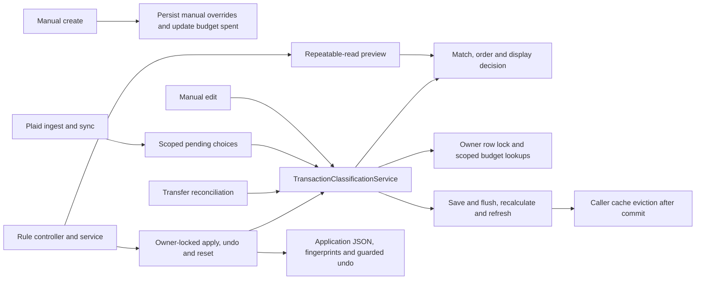

# Increment 9A categorization preparation

This increment reviews architecture and pins existing behavior. The preparation branch starts at `be6f366eee9a8777ff38d6cb6a0e4ef4d109f128`, the merge of PR #27 into the default branch `main`. PR #25 was previously integrated through `d85998a`. There is no remote or local `dev` involved in this increment. A separate worktree preserves the original checkout's three local Flyway edits and independent `sites/` repository.

PR #27 leaves the versioned migrations intact. In validate-only startup, an exact configured approved version now permits a current Flyway `BASELINE` marker after the existing validation and history checks. Unapproved markers still fail. Test startup continues to exercise migrations on a fresh database using its migration-enabled profile. No production baseline, migration configuration, or data was touched.

## Consolidation review

The baseline ArchUnit run inspected 321 production classes. It passed all exact legacy inventory/exception checks. No stale entries were detected and none were removed. Six registry entries cover scoped workflows, and `shared` is partial because it holds a reusable rule. The registry should continue to describe endpoints rather than entire bounded contexts.

| Priority | Finding and impact | Decision and risk |
|---|---|---|
| Medium | Setup, currency and income update each flatten the same profile fields. Income profile separates identity facts from amounts. Four HTTP mappers repeat the same DTO assembly. A new profile field can drift. | Defer until another profile contract change provides a reason to consolidate. An outer mapper over a stable profile projection may help. Keep selected-month versus UTC-current-month policies with their operations. Moving the shape now risks wire and timestamp drift. |
| Medium | `SetupAccountStore.LockedAccount`, `CurrencyAccountStore.LockedAccount` and `IncomeBaselineStore.LockedOwner` each wrap the managed user and repeat scalar profile mapping. Setup also retains its income upsert and dirty-checked flag. Currency explicitly saves the user. Income updates only the baseline. | Keep the ports. They expose different capabilities and lifetime requirements. A shared locked-user interface would allow unrelated writes and blur transaction owners. Consider sharing only an outer read projection later. |
| Low | Setup and currency wire full financial eviction; income update wires summary-only eviction. A generic `Consumer<String>` can obscure which regions an operation affects. | Keep the current wiring and the shared invalidator. Use a named capability when a new use case needs multiple effects or the callback contract becomes unclear. Do not unify scope. |
| Low | `FinancialReportService` still bridges the report controller, cached summary and monthly insights. Monthly insights also use its percentage helper, which reaches into the report calculator. | Keep the bridge until the remaining consumers migrate. Remove its mixed result/compatibility API in that slice. Premature removal risks breaking consent and snapshot behavior. |
| Low | Several packages are organized around operations rather than a single umbrella account feature. `shared.domain.CurrencyChange` has demonstrated consumers in setup and currency. | Keep current ownership. The shared decision is real, whereas grouping the locked account stores or legacy income services would add migration risk with little payoff. |

The recurring detector and JDBC report calculator provide independently testable policies. The recurring outer cache preserves the DTO serialized in Redis. Reporting's snapshot runner covers JDBC and JPA reads, maintains transaction participation and maps wire records. The income/profile read has a separate snapshot and query port because its expected and actual amounts, validation and SQL differ from the authoritative report. The write ports invert actual persistence dependencies. No unused compatibility contract or interface without a meaningful boundary was identified among these slices. Consolidation is deferred. No production package or contract is changed by 9A.

## Categorization dependency and side-effect map

Manual creation sets name/category overrides and, for an owned budget, anchor/category intent. It saves directly and adjusts spent atomically. Editing writes manual fields and budget intent, reconciles transfers when applicable, classifies with invalidation disabled, then evicts the old/new summary months and recurring cache. Plaid ingestion keeps provider facts distinct, inherits scoped pending choices and classifies under the existing writer protocol. Transfer reconciliation can also call a separate direct pending-to-posted inheritance helper before reclassification.

The classifier locks the owner, may attach a rule snapshot, computes display values, checks for a same-month owned anchor and otherwise finds or auto-creates an owner/category budget in a half-open UTC month. It assigns, saves and flushes the transaction, recalculates affected budgets when the link changes, refreshes the target and optionally registers after-commit eviction. Budget uniqueness is database-enforced; the owner lock serializes participating writers. Budget totals include signed expense amounts and exclude transfers. The decision's anchor lookup currently occurs before the assignment gate and can be followed by a second lookup during assignment. Do not optimize that during policy extraction.

Rule writes scope by owner, check revisions and use database `clock_timestamp()` for new creation and every effective timestamp. Preview does not lock the owner. It pages owned transactions by date descending, ID ascending in batches of 256 and rejects the 501st matching row. It uses the current ordered rules with no effective-time filter. The token is SHA-256 over UTF-8 JSON containing owner ID, target view, ordered rule views, ordered matches and ordered transaction fingerprints. A fingerprint binds ID, serialized before-state shape, date, amount, type, transfer flag and provider/source facts. Apply takes the owner lock, recomputes and compares the token, skips non-winners and rules-disabled rows, snapshots the selected rule and writes a journal of changed before-states and after-fingerprints. Undo validates every row, old budget identity/category and fingerprint before restoring anything. It then restores provenance and reclassifies without selection. For an unprovenanced row, this recomputation can return `Uncategorized` even if the saved display category was different. The test pins this existing behavior for review. Undo and apply schedule eviction only for nonempty changes.

The pending bridge scopes retained choices by owner, item, account and pending ID. It prefers a compatible live pending row over its retained JSON, fills missing posted overrides and snapshot fields, propagates opt-out and consumes a used handoff. Keep this protocol and the separate transfer-reconciliation inheritance path distinct until both are characterized for a later migration.

## Matching and precedence

| Area | Existing behavior |
|---|---|
| Candidate filters | Enabled only. Direction and account are exact and case-sensitive when specified. Provider-category comparison uses matcher normalization. |
| Field | `DESCRIPTION` reads raw description. Other fields use provider name when non-null, otherwise current name. A blank provider name counts as present. |
| Match mode | `EXACT` uses raw equality, including two nulls. `NORMALIZED_EXACT` and `CONTAINS` use NFKC, root lowercase, runs of non-letter/non-number characters as spaces, then trim. Unknown non-null mode fails. Empty normalized needle matches contains in the matcher, even though rule save rejects it. |
| Ordering | Persistence orders by priority ascending, creation ascending, ID ascending. The matcher filters supplied order. |
| Live selection | First matching effective rule only. The timestamp boundary is inclusive and a null transaction creation time bypasses it. Selection is suppressed by existing snapshot ID, legacy classification, rules disabled or caller opt-out. |
| Historical selection | Preview and automatic reset use the first current match without the live effective-time gate. For a losing target or rules-disabled transaction, preview returns current display/budget values. Protected manual overrides are surfaced. An override can coexist with a new rule snapshot. |
| Name | Manual override → rule display name → legacy stored name/current name, or nonlegacy provider/current name. A final null or blank becomes `Unknown transaction`. |
| Category | Manual override → rule category → legacy stored/current category, or nonlegacy provider category → `Uncategorized`. Non-null blank overrides still win. |
| Budget category | Owned anchor category → explicit override category → rule budget category → legacy budget category when legacy → final category. Only expense non-transfers can be assigned. A same-month owned anchor supplies the actual budget. An owned older anchor still contributes its category. A foreign anchor supplies neither. |

`CategoryNormalizer` is separate. It formats canonical display/budget labels, including hierarchy separators, title casing and connectors, and returns null on blank input. Matcher normalization performs Unicode compatibility normalization and returns an empty string for blank input. Substituting one for the other would alter both matching and persistence.

## Proposed sequence

- **9B** Extract plain facts-based matching and display/budget-intent decisions, then delegate the legacy entry points to the one implementation. Inputs include raw provider/display facts, optional conditions, ordered rules, creation/effective instants, provenance/override fields and an owner-resolved anchor category. Outputs include match, optional selected snapshot identity and revision, final display name/category and budget-category intent. Keep selection gates explicit. Do not move owner locking, budget lookup order, assignment, snapshots, flush, reconciliation or cache behavior. Keep modes and fallbacks unchanged, including blanks and unsupported values. The policy reads supplied facts and has no framework or repository dependencies.
- **9C** Adapt preview to the shared policy with historical selection semantics. Keep repeatable-read, keyset paging, detach behavior, fingerprint inputs, JSON property order and token text unchanged. Add a golden wire fixture if changing serializers or representations.
- **9D** Separate guarded apply and undo only after tests verify stale previews, revision checks, transaction journal bytes, conflicts and rollback effects. Review the existing unprovenanced-undo outcome separately before considering a fix.
- **9E** Defer pending handoff and transfer reconciliation until compatibility fixtures pin both inheritance paths and stored choices JSON. Preserve scoped consumption and transaction identity when pending and posted arrive on different pages.

These are proposals for later approval. Production source, migration history and the migration registry remain unchanged.

## New cases

- Five matcher and decision tests pin raw merchant/description selection, NFKC/contains and blank values, direction/account/category conditions, caller-supplied candidate order, and display/budget fallback precedence.
- Four PostgreSQL tests pin priority/creation/ID ties versus inclusive live effective time, owned versus foreign anchors across UTC months, database rule timestamps and ordered preview/journal hash inputs, and the 500-match historical ceiling.
- One PostgreSQL and Redis test pins history, categorization, budget totals and owner cache keys across rollback and commit. Existing stale-preview, protected-override, undo-conflict, provider/manual contention and pending-handoff tests run unchanged.
