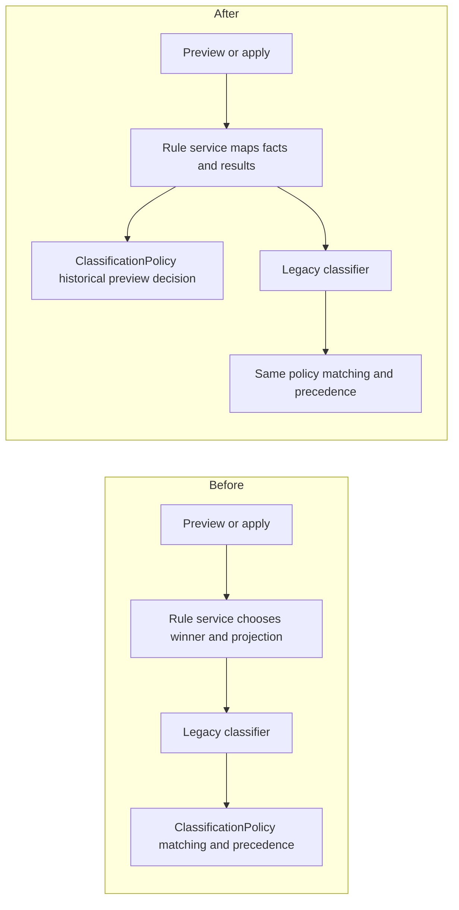

# Increment 9C · Historical categorization preview

The scope is the per-transaction projection decision in `CategorizationRuleService.computePreview`. The HTTP preview endpoint and apply's stale-token check both use that method.

`ClassificationPolicy.historicalPreview` consumes the target ID, matching IDs in repository order, rules-disabled state, and three nullable overrides. It returns the historical winner, whether the row has a protected override, and whether to project the winning target. A blank override counts as present. A protected manual override can coexist with projection, where the existing classification precedence still determines the displayed values. A disabled transaction retains current values even when it has a winner. Historical selection uses the first current match independently of live effective-time gating.

The pure operation makes the shared preview/apply projection decision directly testable. Matching and precedence use the existing 9B implementation. The outer rule service performs the anchor lookup only when it projects the target, maps the existing response, and reuses the same ordered IDs in the token. Paging, detach, hashing, owner scoping, transactions, and writes remain in their original locations.

## Compatibility evidence

`HistoricalPreviewPolicyTest` exercises empty and ordered candidates, target win/loss, disabled transactions, and each nullable override, including blank values. `HistoricalPreviewGoldenIntegrationTest` uses fixed synthetic IDs and rule timestamps, fixtures recorded from the pre-extraction implementation, and PostgreSQL. It compares full HTTP response bytes for a winning, losing, and disabled target, and the stored apply journal including after-fingerprints. The synthetic SHA-256 values are stored separately from the response fixture and restored before comparing bytes. The test also verifies owner-scoped lookup, apply with the preview token, and the exact stale-token status and message.

The 9A characterization suite continues to cover live versus historical effective time, budget anchor resolution, the 500/501 boundary, preview/apply/undo, and budget totals. The wider suite covers PostgreSQL transaction and locking behaviour, Plaid pending inheritance, and healthy Redis and outage scenarios.

The registry retains partial categorization status and the legacy exception ledger has no changes. A subsequent, separately approved increment should isolate locked historical apply and guarded undo around the existing journal with its current bytes and conflict rules. Historical effective-time semantics and the known unprovenanced undo outcome remain separate decisions.

## PostgreSQL statement comparison

The disposable PostgreSQL 18.3 instance logged identical statement text and sequence for the original and migrated versions. Counts include test setup and assertions within each fixture transaction. Transaction-control statements, prepared statement handles and bound values are outside the comparison.

| Fixture | Original | Migrated |
|---|---:|---:|
| Golden HTTP variants, apply and stale replay | 83 | 83 |
| Live effective time and historical preview | 57 | 57 |
| Owned, older and foreign budget anchors | 34 | 34 |
| Preview at 500 and 501 matches | 516 | 516 |
| Preview, apply and undo | 40 | 40 |

No latency benchmark was run.
