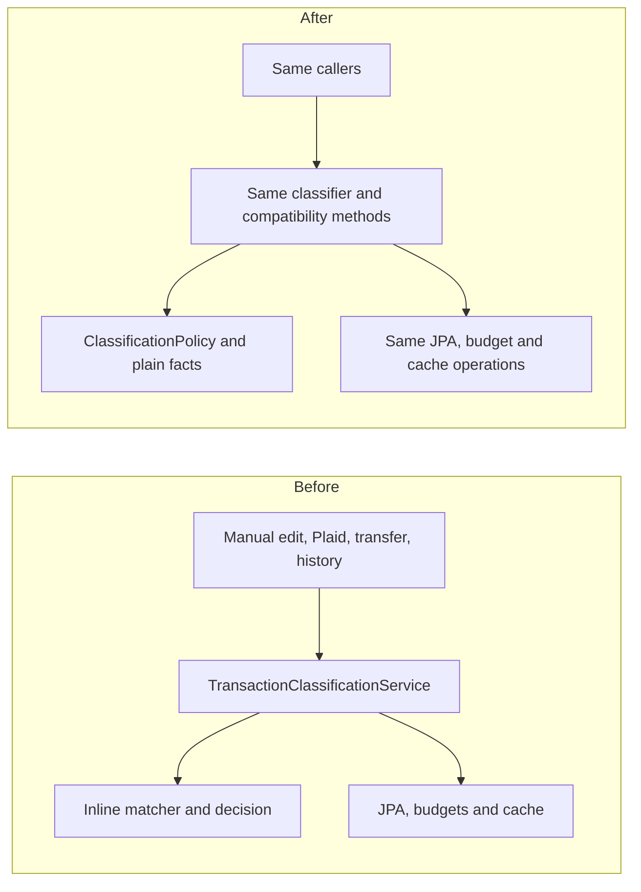

# Increment 9B classification policy extraction

The extraction starts at `15198a3`, the merge of PR #28 into `main`. A separate worktree preserves the original checkout's local Flyway changes and `sites/`. Scope is deterministic transaction matching, live selection and display/budget intent. Repository ordering, owner locks, snapshots, budget assignment, transaction flush, spent recalculation, refresh and after-commit eviction remain in the legacy classifier.

## Dependencies

`ClassificationPolicy` accepts raw matching fields, rule conditions, the live selection flags, an ordered vector of matching rules' effective instants, display/provenance facts, optional snapshot actions, and optional owner-resolved anchor category. It returns match and selection results, an index into the ordered matching list when applicable, and the final name, category and budget-category intent. The service uses the selected index to snapshot the original rule entity. Policy facts and outputs are records with Java-only types. The classifier remains an adapter for JPA-backed entities and keeps its existing method signatures.

`normalize` is still the NFKC matcher behind rule validation. `CategoryNormalizer` continues to format canonical category labels independently. Both `matching` entry points retain input order. They finish filtering before the live effective-time pass, preserving evaluation order, inclusive effective instants and null transaction creation time. Preview and automatic reset still take their first current match without applying the live selection gate. Rule edits and historical workflows continue to use the existing database time and serialization paths.

The policy receives a nullable anchor wrapper so an absent anchor stays distinct from a present one with a null category. The existing owner-scoped lookup contributes category intent even for an older anchor. The classifier still performs its separate assignment lookup and checks UTC month, owner, expense type and transfer status as previously. It keeps the old/new budget recalculation and refresh sequence. No query, cache region, transaction annotation, controller, manual write, preview/apply/undo workflow or provider integration changes.

## Parity and risks

Six plain policy tests exercise raw and normalized modes, null and blank behavior, conditions, live ordering and suppression, snapshot/override/legacy fallback, and budget anchor intent. The existing 9A fixtures verify precedence, matching rule identity, snapshots, PostgreSQL budget assignment and spent totals, preview field order and recomputed token bytes, persisted journal/fingerprint bytes and the current undo outcome. The same fixture assertions run on both versions. Generated fixture IDs differ between the two databases. History and pending handoff production code remain unchanged.

A repeated owner lock or budget anchor query remains a separate optimization decision. Existing history uses a deliberately different winner policy. A future preview migration should retain that policy and add an immutable wire fixture before altering the preview adapter or serializer. The registry is partial because database and historical orchestration still reside in the legacy service classes.

The next proposed increment is **9C**, integrating preview with the pure boundary while preserving its read-only repeatable-read snapshot, pagination, limits, detach behavior, and byte-for-byte token contract.

## PostgreSQL statement comparison

The test database logged identical SQL statement text and order on both versions for the following characterization transactions. Counts include fixture reads and writes in the test transaction. Transaction-control statements, prepared statement handles and bound values are outside this comparison.

| Fixture | Original | Extracted |
|---|---:|---:|
| Live effective time and historical preview | 57 | 57 |
| Owned, older and foreign budget anchors | 34 | 34 |
| Preview at 500 and 501 matches | 516 | 516 |
| Preview, apply and undo | 40 | 40 |

No latency benchmark was run. Facts and the effective-time list are allocated in memory. The equality result concerns database work.

A separate PostgreSQL replay used identical synthetic owner, transaction, budget and rule IDs and fixed rule timestamps in both checkouts. It compared the raw serialized preview (including token and ordered matches) and stored apply journal (including after-fingerprint) and found byte-for-byte equality. The preview was 354 bytes with SHA-256 `e325ca666d97779a06992a8ed620c2b88c45928b57ce4add4fb335d77666f900`. The journal was 477 bytes with SHA-256 `791a104c7c3740e4b94fcfccae57c6b5a17ece0c78955ca1a7ba15ee44e74798`. The replay ran in isolated databases and is separate from the committed 9A fixture tests.
