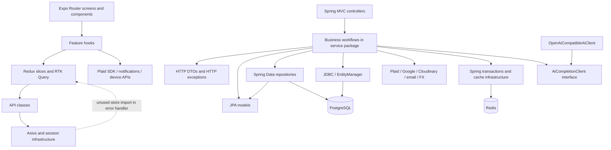
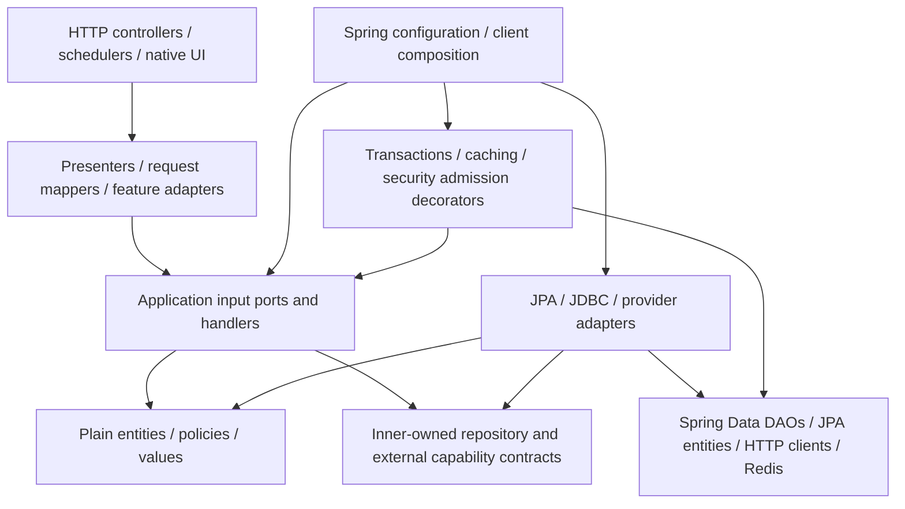

# Fundleaf: Clean Architecture audit and incremental refactoring proposal

Date: November 17, 2026 (America/Toronto). Status: **Increment 1 enforcement implemented locally; all business-feature migrations remain proposed.**

## Increment 1 update — boundary enforcement complete

Increment 1 is implemented in local enforcement commit `b06454261d5e227a8d2dbb055b6adab068035aff`; it is **not pushed**. [Architectural conventions](clean-architecture-conventions.md) now define the layer matrix, contract/package ownership, DI/transaction/cache/security boundaries, exceptions, completion criteria and execution commands. No runtime/frontend source, route, schema or business workflow was changed.

ArchUnit 1.4.1 is a test-only core dependency using the existing JUnit engine. Production bytecode checks enforce new core dependencies, cross-feature access, controller/persistence separation, adapter contracts, injection and relevant component cycles. Exact inventories of 239 legacy classes and 2,327 member-level exceptions replace broad legacy exclusions. New violations and stale fixed entries fail; no runtime baseline expansion is supported. A feature registry reports zero migrated features and rejects empty/missing/package-marker completion claims. Adapter-to-DAO access and inward compatibility facades are deliberately permitted.

Twenty-six architecture tests pass, including isolated counterexamples and valid collaboration fixtures. Full Java 17 clean verify passes **809 tests, 0 failures/errors, 11 unchanged skips**, including all 783 previously passing tests; compilation/packaging and applicable actual hooks pass. The new CI workflow runs the same architecture-only command, but no hosted execution is claimed before an approved push. [The updated baseline](clean-architecture-baseline-2026-11-17.md) records the exact checks and initial compiler-output snapshot correction.

Decisions relative to the proposed Increment 1 card: frontend restricted-import enforcement and F10's unused-import cleanup are deferred to Increment 12; no frontend configuration or source is modified. Endpoint/transaction characterization remains required before each owning migration, rather than adding a global HTTP inventory here. Component cycles collapse adapters/infrastructure into one outer component and exclude composition as a cycle source, with a separate rule preventing new imports into configuration. This preserves the course's adapter→DAO collaboration instead of imposing an incompatible onion-layer restriction. F12 now has local CI configuration; its ambiguous PATCH/PUT route behavior remains unchanged and unresolved.

Next proposed increment: recurring-payment read pilot (Increment 2), only after separate approval, with output/HTTP characterization first and healthy Redis verification before declaring the cached flow complete. All original findings below remain historical audit evidence; no business feature is declared clean merely because its future packages are absent.

## Prerequisite checkpoint update

The approved prerequisite increment is complete. No architectural refactoring or boundary-enforcement implementation has begun. [The updated baseline](clean-architecture-baseline-2026-11-17.md) records exact repairs, files, commands, commits and limits. Backend Java 17 clean verify now passes **783 tests, 0 failures, 11 skips**; client **573 tests** pass and Jest exits naturally. TypeScript, zero-warning Expo lint, platform exports and applicable commit hooks pass. Broader ESLint retains 98 explained existing warnings with zero errors.

The formatter's invalid flag, actual changed-file formatting, V34 migration assertions, duplicated JWT test-key literal and Jest resource lifetime were repaired. Core architecture findings remain valid; F12's checkpoint tooling/migration-assertion blockers are resolved, while its API mapping/CI observations remain open. No historical migration SQL was changed.

Implementation checkpoint `dc0b29b583239ce97f6f777007a0f00ca5388d2e` was pushed to `origin/dev` and independently verified with `git ls-remote`. Original feature checkpoint is `094359153e17cde315e2c9237f088f5001e3304a`. The documentation-only successor's hash is recorded in the completion report. The original Git/test sections below preserve the initial investigation state and should be read as historical, superseded by this update for checkpoint status and validation counts.

`sites/fundleaf-budget` was inspected and is a clean independent nested Git repository containing a generated hosted website and hosting metadata. It remains untracked and untouched in this application repository; keeping it separate is recommended. Healthy Redis and native/device integrations remain explicitly unverified because the required local infrastructure/tooling is unavailable.

Increment 0A is complete. The next recommended increment is **Increment 1, subject to separate approval**. Increment 2 (recurring pilot) and all subsequent migrations remain proposed. Initial source line numbers describe the pre-format audit snapshot; the clickable evidence index is refreshed for the checkpoint.

## 1. Decision and scope

Retain the Spring Boot modular monolith, PostgreSQL, Redis, Expo application, existing public APIs, database schema, security rules, and background processing protocols. Introduce Clean Architecture through complete feature slices, beginning with recurring-payment detection. Do not reorganize all files first. Favor feature packages containing four architectural boundaries over four enormous application-wide layer directories.

The code is a working conventional controller/service/repository application with substantial correctness engineering. Its central problem is policy mixed with technical mechanisms, rather than a lack of service classes. Moving existing services into an `application` directory would not solve their actual dependencies.

This report adapts the SEG3102 conventions supplied in the assignment. No separate course handouts were supplied or used. No application implementation, migration, dependency, test expectation, or hook configuration was deliberately changed. Only audit documents are added. A commit hook briefly removed two trailing blank lines from one test; its working-tree bytes were restored from the original staged blob. The original index remains intact. Untracked `sites/` is outside the tracked application's audit scope and was neither staged nor edited.

## 2. Git checkpoint

| Item | Observed state |
|---|---|
| Repository | `https://github.com/Jatti045/fintech-platform.git` |
| Branch / upstream | `dev` / `origin/dev` |
| Existing HEAD | `bd4e8626f99e09a57853473e708b8923606303b3` |
| Remote verification | `git ls-remote origin refs/heads/dev` independently returned the same hash |
| Unpushed existing commits | None against the configured upstream |
| Staged work | 48 files, 1,348 insertions, 118 deletions: first-time account setup, routing/session protections, owner-only live Plaid linking, associated tests/docs, version 4.2 / Android code 74 |
| Initial unstaged tracked changes | None |
| Initial untracked work | `sites/`, left untouched |
| Proposed checkpoint message | `Add first-time account setup and restrict live bank linking` |
| New checkpoint commit / push | **Blocked; neither occurred** |

Reviewed staged diff and filenames, including application properties, migration V34, client configuration, backend/client implementation, and test fixtures. No staged `.env`, service-account key, generated build directory, or private credential was identified. A targeted credential-pattern scan found no matches; the installed private-key and Gitleaks commit checks passed. Public app identifiers and test credentials are not private provider credentials. This is a staged-change review, not a guarantee about the entire Git history.

The actual commit attempt stopped at mandatory local checks:

1. `end-of-file-fixer` changed trailing blank lines in `fintech-api/src/test/java/com/fintechapp/fintech_api/controller/AuthControllerSecurityTest.java`. The audit restored only this hook-generated change to the original staged bytes.
2. The Expo hook specifies `--max-warnings 0`; three existing effect-dependency warnings in `BudgetModal.tsx` and `TxModal.tsx` make it fail.
3. `google-java-format` rejects configured option `--java-17-plus` with installed version 2.0.0.

No hooks were bypassed, unrelated fixes staged, history rewritten, or force push attempted. There is no new commit to push. The existing remote HEAD is verified, but **the staged work is not remotely checkpointed**. Resolve these checks in an explicitly approved prerequisite increment, then commit precisely the intended staged work and verify the remote hash. The later full test run also identified two stale migration assertions associated with V34; those should be resolved before treating the checkpoint as validated.

## 3. Codebase overview

### Backend

`fintech-api/pom.xml` declares Java 17 and Spring Boot 4.0.3. It uses Spring MVC, Security, Data JPA/Hibernate, JDBC, PostgreSQL, Flyway, Redis caching, JavaMail, Google token verification, Cloudinary, and an OpenAI-compatible client behind an existing interface. `FintechApiApplication.main` is the entry point. Spring component scanning plus `config/*` construct the application. Docker builds with Java 21 while Maven targets 17. `fly.toml` describes Fly deployment; it is configuration evidence, not proof of the current hosted deployment.

The main Java tree contains 156 files: 14 model files, 11 repository files, 47 service files, 11 controllers, plus DTOs, security, configuration, exceptions, and AI integration. Ten model files import JPA. All eleven repository files import Spring; they are persistence mechanisms, not technology-independent domain repository contracts. Forty-three service files import Spring.

Feature areas: authentication/recovery/session revocation; profile/account setup/income/currency; manual transactions and budgets; categorization rules with guarded historical apply/undo; authoritative reporting; recurring bill detection; AI explanations and consent; Plaid linking, signed webhooks, synchronization, transfer/refund classification, durable revocation and recovery; image upload and cleanup.

### Frontend

`client/package.json` uses Expo SDK 54, React 19.1, React Native 0.81, Expo Router, TypeScript, Redux Toolkit/RTK Query, Axios, SecureStore, encrypted AsyncStorage snapshots, local notifications, Google sign-in and Plaid native integrations. `expo-router/entry` loads `app/_layout.tsx`. Router files compose screens; hooks coordinate behavior; components largely present data; `api/*` handle HTTP; RTK Query owns month-scoped server state.

The audited non-generated, non-test TypeScript graph contains 197 files. `useProfile.ts` is 917 lines, `apiSlice.ts` 656, and `userSlice.ts` 546. Size is a navigation signal; the findings below are based on responsibilities and actual imports.

Frontend design should remain idiomatic React. UI state, hooks, RTK endpoints and native platform adapters need not imitate backend repositories or aggregates. Only policy/orchestration extracted from those files needs framework-independent boundaries.

### Configuration, build and test ownership

- `README.md` and `fintech-api/src/test/README.md` define developer commands and native integration limits.
- `docs/database-migrations.md` explains validation-only normal startup, test migration opt-in, historical V15/V15.1 ordering and forward-only release procedures.
- `docs/plaid-connection-recovery.md` and `docs/background-worker-reliability.md` document single-use token reservation, compensation, leases, retry recovery and cleanup.
- `docs/authoritative-financial-reporting.md` records UTC periods, signed refunds, reconciliation and reporting snapshots.
- `docs/transaction-categorization-rules.md` specifies precedence, provenance, preview tokens and undo constraints.
- `docs/security/financial-cache-ai-privacy.md` documents client session/cache isolation and AI consent admission. Some historical wording about schema auto-patching is older than the current validating migration configuration; implementation remains authoritative.
- `.pre-commit-config.yaml` performs hygiene/security, Expo lint, TypeScript, Java formatting and Docker checks. No tracked GitHub Actions workflow was found. Docker packaging skips tests, so it does not independently enforce the baseline.
- No applicable `AGENTS.md` was found in the repository or checked ancestor paths.

## 4. Current architecture and actual workflows

Arrows below represent source dependencies, except explicitly labeled runtime flow.



### A. Manual transaction creation

`client/hooks/transaction/useTransactionOperation.ts` → RTK mutation in `store/api/apiSlice.ts` → `api/transaction.ts` → `TransactionController.createTransaction` → `TransactionService.financialWrite/createLocked` → locked user, submission lookup, currency preparation, classification, transaction persistence, budget aggregate changes and after-commit eviction. `TransactionSubmissionRepository` persists request fingerprint and serialized original response. A cache miss for FX aborts/retries the write around an out-of-transaction fetch, then revalidates under lock. This is not safely replaced by a generic `save(Transaction)` abstraction alone.

### B. Reporting

Home/Budget hooks consume the shared report query. `FinancialSummaryController` → `FinancialReportService.report/facts` → user/income/budget repositories and grouped JDBC transaction queries. `REPEATABLE_READ` spans current/previous periods and related facts. BigDecimal reconciliation ensures daily/category totals match overall totals. This endpoint deliberately avoids the legacy Redis summary cache. Pagination/search affects browsing, not report totals.

### C. Plaid webhook and synchronization

`PlaidController.handleWebhook` checks signature/body hash before parsing; verified payload goes through `PlaidWebhookService` to durable job recording. Successful acknowledgement means job persistence succeeded. `PlaidSyncJobWorker` claims work → `PlaidTransactionSyncService.syncItem` renews item lease → `PlaidService.fetchAndApplySyncPage` stages external pages without DB transactions → final transaction locks user and item, validates lease token/expiry/start cursor, applies complete sequence and advances cursor atomically. Cache eviction occurs after commit. Provider pagination mutation restarts the staged attempt. These runtime relationships must survive new source boundaries.

### D. New account setup

Root routing blocks Home for unfinished/unknown setup state. `account-setup.tsx` → user thunk → `UserAPI.completeAccountSetup` with expected session generation → `UserController.completeSetup` → `UserService.completeSetup`. The locked account enforces currency immutability once financial data exists, writes current UTC income and completion together, and treats a repeat completion as an idempotent profile read. V34 grandfathers existing accounts. Keep this behavior while splitting profile orchestration later.

### E. Profile image replacement / account deletion

`UserService.uploadProfilePicture` validates `MultipartFile`, uploads outside a database transaction, then `ProfilePictureStore.replace` locks and replaces the reference and durably enqueues the old asset. Failed attachment queues compensation separately. Account deletion queues encrypted Plaid revocations and image cleanup alongside local deletion. External cleanup must continue after the user row disappears.

### F. AI generation and recovery

`MonthlyInsightService.generateForAuthenticatedUser` takes a locked user and repeatable-read facts, verifies consent/version, builds a restricted context and calls `AiCompletionClient`. The lock intentionally remains held through provider completion so opt-out serializes with admission. `PasswordRecoveryService.verify` intentionally commits failed-attempt counters on selected client errors through `noRollbackFor`; default rollback semantics would silently weaken protection.

## 5. Existing strengths to preserve

1. Controllers mostly delegate; the application is already separated from UI rendering and much transport plumbing.
2. Most backend collaborators use constructor injection. Existing `AiCompletionClient` demonstrates a useful replaceable provider boundary without an interface per class.
3. `AuthenticatedUser` is a plain Java record, not Spring Security's `Authentication`/`UserDetails`. Its current DTO package placement is imperfect but it is not itself framework-coupled.
4. SQL constraints, atomic budget updates and `Budget.@DynamicUpdate` prevent stale entity writes from losing concurrent spending changes. `User` has optimistic versioning and non-updatable credential/session fields, with atomic credential updates in the repository.
5. Durable jobs, leases, fencing and compensation are substantive reliability design. Retain separate transactional lease beans; `PlaidSyncLeaseStore` explains the previously encountered self-invocation/proxy problem.
6. `FinancialCacheInvalidator` registers after-commit work, tolerates Redis failures and preserves targeted keys/TTLs. Avoid replacing it with premature event infrastructure.
7. Reports use authoritative server facts and complete months, including signed credits/transfers, rather than UI-page aggregates. Existing report concurrency tests are valuable.
8. Client session serialization, generations, encrypted per-user snapshots and centralized state reset prevent old responses/writes from resurrecting another session.
9. RTK month/filter cache keys, deduplicating pagination and explicit invalidation are useful boundaries. Keep server-state ownership there.
10. The automated suite already covers real PostgreSQL migrations, ownership, concurrent writers, cursor fencing, recovery, signed webhooks, consent, session expiry, UI failure states and cache behavior. Strengthen boundary tests rather than rewriting these as mock-only tests.

## 6. Detailed architectural findings

Priority reflects practical impact, not strict-compliance score. No Critical architectural defect was established by this audit. High means a consequential coupling or correctness-sensitive migration; it does not imply a demonstrated exploit or current data corruption. Paths below are exact repository paths; the linked evidence index provides absolute file links.

### F1 — High: framework persistence models serve as the business model

**Evidence:** `fintech-api/src/main/java/com/fintechapp/fintech_api/model/Transaction.java` (`@Entity`, mutable setters, `isExpenseCredit`), `model/Budget.java` (`@DynamicUpdate`, mutable `spent`), `model/User.java` (`@Version`, credentials and profile associations); `repository/TransactionRepository.java` extends `JpaRepository` and `JpaSpecificationExecutor`.

**Problem/principle:** The apparent domain model is also the Hibernate model. Domain invariants are distributed across workflows rather than protected by business types. This violates the strict Domain independence target and weakens SRP/DIP; it is normal layered persistence architecture, not an incorrectly implemented domain repository interface.

**Existing → target dependencies:** business service → JPA model/Spring repository; target use case → domain object/domain contract ← repository adapter → existing JPA entity/DAO.

**Consequence:** Testing a rule can require constructing persistence relationships; generic entity saves risk overriding protected fields/aggregates if mappings are naïve. Schema/provider metadata changes touch business-policy code.

**Recommendation:** Introduce plain domain representations per migrated slice. Retain existing JPA classes as persistence entities initially, without table renames. Explicit mappers must distinguish create/update/read and preserve database-generated IDs/timestamps, optimistic version, credential fields, native query results and lazy relationships. Do not deep-copy entire object graphs or blindly `merge` detached domain objects. Add behavioral operations only for real invariants: transaction classification/eligibility, category normalization, monthly period and account currency restrictions. Avoid a new Money representation/rounding change during this migration.

**Risk:** High for transaction/user writes; low-to-medium for a read projection. **Sequence:** recurring read pilot first, write models later.

### F2 — High: TransactionService combines policy, query construction and persistence orchestration

**Evidence:** `service/TransactionService.java`: `getTransactions` (line 100), `financialWrite` (line 58), `createLocked` (line 201); 834 lines. Imports include `Specification`, `PageRequest`, `EntityManager`, request/response DTOs, repositories, concrete FX/cache/transfer services; classification and transaction manager are field-injected.

**Problem/principle:** SRP and DIP. Filtering/paging/JPA predicates, transport parsing, currency retry boundaries, idempotency, ownership, financial mutations and response mapping share one class. Constructing it manually does not provide every production dependency; `financialWrite` even permits a missing transaction manager in direct tests.

**Existing → target:** controller → concrete service → JPA/HTTP/Spring; target controller → operation input port → plain use case → narrow persistence and FX ports, with outer transaction runner and HTTP presenter.

**Consequence:** Changes to one operation have broad test setup and regression surface; test-only null fallbacks can conceal wiring errors.

**Recommendation:** Separate list/create/update/delete/reset operations one at a time. Translate HTTP query strings into framework-free query criteria at the web boundary; construct Specifications in persistence adapters. Preserve response serialization/fingerprints and optional legacy idempotency behavior. Domain contracts must express atomic financial operations and ownership/lock requirements, not merely mirror JpaRepository.

**Risk:** High; FX retries, idempotency, user lock order, refresh/flush and atomic `spent` updates must remain equivalent. **Priority:** after read pilot and rule/FX seams.

### F3 — High: Plaid business workflow depends on transport and persistence details

**Evidence:** `service/PlaidService.java`: `SyncAttempt` stores `List<JsonNode>`; `fetchAndApplySyncPage` (205) owns HTTP, decryption, cursor staging, rate preparation, locked final commit, ingestion, reconciliation, cache invalidation and persistence; `post/toPlaidTransaction` parse provider data. `service/PlaidConnectionService.java:connect` reserves a single-use exchange and coordinates compensation.

**Problem/principle:** SRP/DIP and provider representation leakage. Provider JSON and `PlaidSettings` from configuration enter workflow code.

**Existing → target:** sync workflow → RestClient/Jackson/config/JPA; target sync workflow → BankTransactionGateway + typed provider-independent batch and persistence capabilities ← Plaid adapter/JPA implementation. Plaid-specific payload parsing stays outermost.

**Consequence:** Provider protocol changes and concurrency semantics are entangled; swapping a provider requires editing orchestration. A folder move could accidentally move framework dependencies inward.

**Recommendation:** Extract the provider gateway first, preserving complete-sequence staging/restart semantics. Then migrate connection, queue and sync slices separately. Keep provider identifiers in explicit external-reference types where they are genuinely required; abstract capability, not all meaningful integration semantics. Keep encrypted credentials out of public/domain objects that do not need them.

**Risk:** Very high. Never split final data application from cursor advancement, replay reserved tokens, weaken lease fencing or discard durable revocation. **Priority:** late migration despite high architectural impact.

### F4 — High: policy and SQL live together in reporting and categorization

**Evidence:** `service/FinancialReportService.java:report/facts/rows/reconcile` (50/57/128/144) mix snapshot orchestration, SQL, monetary reconciliation and `FinancialReportResponse` nested records. `service/TransactionClassificationService.java:matches/decision/classify` (31/88/61) mixes precedence rules with budget lookup, user lock, save/flush/refresh and cache eviction. `service/CategorizationRuleService.java:save/preview/apply/undo` also directly uses JdbcTemplate, EntityManager, Jackson and persistence entities.

**Problem/principle:** SRP/DIP; business policy cannot be exercised independently of database-shaped inputs. `decision` sounds pure but performs a repository lookup for budget override.

**Existing → target:** policy → database/HTTP DTOs; target plain policy → facts supplied by use case, while use case → snapshot/query/locking contracts ← SQL/JPA adapters.

**Consequence:** Rule precedence, undo safety and totals can diverge when edited in different paths. Extracting SQL into multiple independent calls risks losing the existing snapshot.

**Recommendation:** Extract `ClassificationPolicy` from prepared facts, retain deterministic ordering and effective-time behavior; keep DB `clock_timestamp()` authority for rule creation/revision. Separate reporting facts retrieval from `ReportCalculator`, keeping all reads in one outer repeatable-read transaction. Application result records precede HTTP mapping. Preserve preview token algorithm and stored before-state compatibility until a separately approved versioning change.

**Risk:** High. Rounding residual allocation, signed credits, legacy overrides, repeatable read, stale preview rejection and guarded undo need characterization first.

### F5 — High: transaction/consent/error semantics are encoded in framework mechanisms

**Evidence:** `service/PasswordRecoveryService.java:verify` uses `@Transactional(noRollbackFor = ResponseStatusException.class)` to persist bad-attempt increments; `MonthlyInsightService.java:generateForAuthenticatedUser/requireUser` locks the account through the provider call; `CurrencyConversionService.java:withPreparedRates` coordinates exceptions and retries around transactions; `PlaidSyncLeaseStore` uses separate REQUIRES_NEW proxy boundaries.

**Problem/principle:** Business workflow and transaction mechanism are coupled. This is not justification to remove transactions. Merely replacing HTTP exceptions can accidentally change rollback rules.

**Existing → target:** workflow → Spring transaction APIs/exceptions; target workflow → explicit plain operation results/capabilities, executed by outer transaction decorators/runners preserving isolation, propagation and failure outcomes.

**Consequence:** A seemingly mechanical exception or injection cleanup can weaken rate limiting, consent serialization or cursor guarantees.

**Recommendation:** Document a transaction matrix before each migration. Move boundaries to explicit outer decorators; inject the decorated implementation at every entry point. For recovery, persist the failure outcome and translate it to HTTP only after the intended commit, or preserve equivalent typed no-rollback handling. For AI, preserve lock-through-call admission until a separately approved protocol proves equivalent. Do not move the provider call out of that lock as a performance cleanup.

**Risk:** Very high; migrate these features independently after simpler contracts prove useful.

### F6 — Medium: HTTP input/output/error types leak into nearly every service

**Evidence:** `UserService.completeSetup/updateCurrency/uploadProfilePicture` accept web DTOs and `MultipartFile`, and return HTTP envelope DTOs. `TransactionService` accepts raw HTTP query-string DTOs and returns success/message envelopes. `AuthService` imports `HttpStatus`, `ResponseStatusException`, `PasswordEncoder`, `JwtService` and Google's verifier.

**Problem/principle:** Application independence/DIP. The plain `AuthenticatedUser` record itself is acceptable; the leak is not a Spring security object passed to domain entities.

**Existing → target:** application → web/framework; target web → application command/result/error; domain has no transport/authentication implementation imports.

**Consequence:** Alternate entry points reproduce transport conventions; unit tests assert HTTP mechanism rather than operation outcomes.

**Recommendation:** Add commands/results only where transport representations differ; do not duplicate every record. Map validation/error status/envelope at controllers/presenters and `GlobalExceptionHandler`. Retain exact status/messages/nullability/zero-based months. Use a plain actor/account identity input; keep JWT email/issued-at/session-version validation in security infrastructure. `GoogleIdentityVerifier`, `PasswordHasher`, `SessionTokenIssuer`, `ProfileImageStorage` and `EmailSender` are justified capabilities when those workflows migrate.

**Risk:** Medium-to-high due to API compatibility and error ordering. **Priority:** migrate with each owning feature, not as one global DTO rewrite.

### F7 — Medium: account/profile workflow has too many reasons to change

**Evidence:** `service/UserService.java` (368 lines) coordinates account deletion, image upload/cleanup, password changes, currency restrictions, setup, incomes, profile summaries and many repositories, with additional field-injected rule/handoff repositories. `AuthService.toUserSummary` and `UserService.toUserSummary` construct the same summary shape separately.

**Problem/principle:** SRP/ISP; lifecycle, security and profile behavior are coupled. Constructor size alone is not the finding; unrelated workflows and hidden field dependencies are.

**Existing → target:** profile service → every concrete subsystem; target focused use cases → narrowly owned contracts, composition root wiring concrete implementations.

**Consequence:** Adding a deletion dependency changes unrelated test fixtures; summaries can drift when setup/income fields change.

**Recommendation:** Migrate setup/income, profile images and account deletion as separate slices; share a deliberately owned profile result assembler. Preserve individual upload/attachment/cleanup phases and atomic credential updates. Avoid a new domain facade spanning all these responsibilities.

**Risk:** High for deletion and credentials; medium for profile reads. **Priority:** after recurring/reporting pilot.

### F8 — Medium: recurring algorithm is deterministic but coupled to JPA and HTTP DTOs

**Evidence:** `service/RecurringPaymentService.java:detectForAuthenticatedUser/detect` (103/119) mixes repository fetch, `Instant.now`, Spring `@Cacheable`, JPA `Transaction`, merchant/cadence detection and `RecurringPaymentsResponse` items across 487 lines.

**Problem/principle:** SRP/DIP. Existing explicit `now` in `detect` is already an excellent seam.

**Existing → target:** detection → JPA transaction/HTTP item; target GetRecurringPayments → ExpenseHistory repository contract + Clock + plain RecurringPaymentDetector → domain expense observations; outer cache decorator/presenter/persistence mapper.

**Consequence:** Algorithm tests construct persistence models; transport evolution can affect policy types.

**Recommendation:** Use this bounded read-only workflow as the pilot. Keep merchant normalization/cadence/window/order/maximum results and 15-minute user cache unchanged. No full transaction aggregate or generic repository infrastructure is needed for the read projection.

**Risk:** Low-to-medium; exact floating point/date/identifier behavior and stale-cache rules still matter.

### F9 — Medium: frontend profile hook combines unrelated orchestration and native integrations

**Evidence:** `client/hooks/profile/useProfile.ts`: imports user/Plaid APIs, Redux/RTK, router, linking, permissions, image-picker service and notifications; `handleLinkBank` (372) dynamically loads Plaid SDK and orchestrates exchange; `handleSaveMonthlyIncome` (678) mixes form/selected-month/request/UI concerns.

**Problem/principle:** SRP/DIP at the client workflow boundary. Hooks depending on React/Redux are expected; they should not be mislabeled as domain services.

**Existing → target:** large hook → API singletons/native SDK/UI feedback; target small feature hooks → focused async workflows with injected API/native capabilities; SDK implementation and Redux/cache integration remain adapters.

**Consequence:** Native timing/session behavior is difficult to test without large module mocks; unrelated changes share a 917-line hook.

**Recommendation:** Split bank connection, income editor, profile image and notification preference responsibilities independently. Extract a typed Plaid session adapter that preserves callbacks, cancellation, single-use tokens and session-generation guards. Leave presentation concerns in hooks/components. Keep existing `useProfile` as a temporary composing facade to preserve screen behavior.

**Risk:** Medium-to-high for stale responses/native callback lifetime. No frontend-wide repository hierarchy.

### F10 — Low: cycles require distinguishing executable imports from types/documentation

**Evidence:** `client/config/apiErrorHandler.ts:1` imports `store` but does not use it. Graph: `api/user.ts → config/apiClient.ts → config/apiErrorHandler.ts → store/store.ts → store/slices/userSlice.ts → api/user.ts`. `hooks/useRedux.ts → store/index.ts` is type-only in the reverse edge; `MonthlyDetails.tsx → MonthlyOverview.tsx` is also type-only. Java explicit-import scan finds `CacheConfig ↔ FinancialCacheInvalidator`, but CacheConfig references the class only in Javadoc.

**Problem/principle:** The unused client import expresses an unnecessary lower-level-to-state dependency. Runtime survival depends on compiler/bundler elision, so this audit does not claim a demonstrated initialization failure. The other edges are not established runtime cycles or bean cycles.

**Existing → target:** HTTP error normalization → store; target store/composition → registered callbacks and plain normalization, with no store import. Shared types can be imported from their owning contract instead of barrels when useful.

**Consequence:** Static architecture checks flag noise; retained side-effect imports could recreate initialization problems. Type-only component references are much lower priority.

**Recommendation:** Remove the unused import in an approved cleanup; use graph checks that separate type-only references, Javadoc and executable dependencies. Do not restructure components merely to eliminate harmless type references.

**Risk:** Low. **Priority:** include in boundary setup after checkpoint.

### F11 — Medium: business access policy resides in configuration

**Evidence:** `config/PlaidConfig.java:PlaidSettings.allowsNewConnections` compares Sandbox URL and owner UUID; `PlaidService.canConnectBank/requireNewConnectionAccess` call it.

**Problem/principle:** Business authorization depends on infrastructure settings' behavior. Configuration should supply normalized facts, not own who may use an application capability.

**Existing → target:** workflow → configuration policy; target workflow → plain BankConnectionPolicy configured by outer composition.

**Consequence:** Environment/provider URL representation controls authorization; tests construct provider configuration to test a business rule.

**Recommendation:** Outer configuration resolves environment and validated owner identity into explicit policy inputs; plain policy preserves the current Sandbox allowance and fail-closed live behavior. Keep server-side enforcement for both token creation and exchange; UI capability is advisory.

**Risk:** High if semantics change, despite small code size. Use all existing owner/unset/invalid/development/Sandbox access integration scenarios.

### F12 — Medium: verification configuration and API contract ambiguity need separate repair

**Evidence:** `.pre-commit-config.yaml` uses unsupported Java-format flag and zero-warning Expo hook; `config/DatabaseMigrationsIntegrationTest.java:56,115` expects terminal migration 33 and two migrations after 31 despite V34. `controller/TransactionController.java:102` stacks `@PatchMapping` and `@PutMapping`; Spring logs that only the first mapping is used. Dockerfile builds with `-DskipTests` and package `build:web` uses a command distinct from the successful export workflow.

**Problem/principle:** Regression protection is unreliable; route annotations do not prove a public contract. This is a baseline correctness/tooling concern, not a fabricated Clean Architecture violation.

**Existing → target:** packaging/local conventions → partial or ambiguous gates; target reproducible checks and explicit route contract evidence before structural changes.

**Consequence:** A valid checkpoint is currently blocked; intended PUT compatibility could differ from actual behavior. A passing bundle/export is not a native integration test.

**Recommendation:** Repair tooling and migration expectations in focused approved commits without changing historical SQL or suppressing assertions. Characterize PATCH and PUT behavior before any mapping change; decide separately whether PUT is an intended contract repair. Do not silently activate a new route during architectural work. Add CI after executable checks are stable.

**Risk:** Low for tooling; medium for route behavior. **Priority:** prerequisite baseline stabilization.

## 7. SOLID evaluation

| Principle | Concrete assessment | Improvement |
|---|---|---|
| SRP | TransactionService combines query parsing/JPA/financial writes/mapping; UserService combines profile/security/destruction; useProfile mixes many independent UI workflows. | Split by meaningful operation and isolate policy from adapters; preserve one orchestrator per atomic workflow. |
| OCP | Plaid/FX/Google/Cloudinary replacement requires editing services; AiCompletionClient already provides extension through an interface. | Add provider capability ports only where needed, reusing the existing AI seam. Avoid turning every switch into strategies: finite rule match modes and known transfer codes are legitimate explicit policies. |
| LSP | No concrete subtype contract violation was demonstrated. JPA repository interfaces and mutable entities are not evidence of LSP failure by themselves. | Define behavior contracts for new adapters, including ordering, absence, ownership, failure, atomicity and concurrency. A fake repository must not silently omit constraints relied upon by the application. |
| ISP | Spring Data CRUD/specification APIs expose more persistence mechanism than each use case needs; useProfile returns unrelated concerns to one screen composition. | Narrow history/report/write capabilities; split hook responsibilities while preserving a composing hook. Do not add one-method wrappers solely for compliance. |
| DIP | Business services import concrete providers, JPA/JDBC, Spring transactions/cache and web exceptions; domain models are persistence entities. | Inner-owned repository/external-service contracts, plain commands/results/policies; outer adapters and composition wiring. Constructor injection alone does not invert ownership. |

## 8. Target structure and communication

Use feature-oriented packages inside one Maven module initially. A package boundary is enough to start; separate build modules become justified only if compile-time enforcement cannot remain reliable. Existing packages remain an explicitly named transitional region until migrated. Create each new directory only when it contains a real migrated component.

```text
com.fintechapp.fintech_api/
  recurring/
    domain/            ExpenseObservation, RecurringPayment, RecurringPaymentDetector
      repositories/    ExpenseHistory
    application/       GetRecurringPayments, GetRecurringPaymentsHandler, result records
    adapters/
      persistence/     JpaExpenseHistoryAdapter, observation mapper
      web/             recurring presenter (if mapping is nontrivial)
    infrastructure/
      web/             RecurringPaymentController, HTTP DTOs
      configuration/   RecurringConfiguration, cache decorator, Clock wiring
  reporting/           domain/application/adapters/infrastructure as needed
  transactions/        domain/application/adapters/infrastructure as needed
  categorization/      domain/application/adapters/infrastructure as needed
  budgets/             domain/application/adapters/infrastructure as needed
  accounts/            profile, setup, income, lifecycle slices
  identity/            credential/session/recovery application and infrastructure
  banking/             link, synchronization, revocation slices
  insights/            consent and explanation capability
  shared/domain/       only genuinely shared stable rules, e.g. AccountingMonth
  infrastructure/
    persistence/       existing JPA entities and Spring Data DAOs during transition
    configuration/     global framework composition, migrations and cache setup
    security/          JWT filter/verifier, HTTP principal conversion
```

The first read projection does not justify moving the entire Transaction entity or renaming every repository. Existing `repository.TransactionRepository` is the DAO-equivalent for a new adapter. Later a feature-owned JPA DAO can replace it when call sites are migrated. Domain contracts stay in domain repositories as requested; application-only capabilities such as FX preparation, AI completion, mail and storage live in application ports. Reporting projections are application query data, not artificial business aggregates.

The user's four-layer convention places controllers in Frameworks and Drivers; use that consistently here. Web presenters/mappers are adapters, routing/HTTP binding belongs in infrastructure. Repository adapters and JDBC/ORM DAOs may be separate when there is meaningful domain/persistence mapping. For simple SQL projections, one outer class may implement both translation and query mechanics; creating a second forwarding DAO provides no architectural value.



At runtime a controller calls a decorated use case; that use case invokes an injected repository interface, whose adapter queries a DAO and maps the result. The use case source imports only the interface. It never imports the adapter merely because runtime control crosses outward.

### Permitted dependencies

1. Domain: JDK and its own domain types only initially; no Spring, Hibernate/JPA, Jackson, HTTP, provider SDKs, DTO envelopes or application packages. Existing enums can migrate if plain. Do not create shared dumping grounds.
2. Application: owning domain, its inner-owned ports, plain DTOs and explicitly exposed application contracts of other features. No controllers, JPA entities/DAOs, Specifications/Page, MultipartFile, RestClient, security framework objects, Redis or transaction annotations.
3. Adapters: inner contracts plus infrastructure APIs necessary for translation. Implement interfaces rather than making the core inherit provider types. Do not return persistence entities or provider JSON through inner interfaces.
4. Infrastructure: owns framework startup, security, transports, scheduling, DAO implementation, transaction/caching decorators and concrete wiring. It can depend inward. Adapters may reference infrastructure mechanisms at their documented outer boundary; prevent a bidirectional package knot by grouping tightly related persistence mechanics in one outer slice where needed.
5. Feature-to-feature: call an exposed application capability or share a narrowly justified domain concept; do not import another feature's JPA entity or controller. Avoid cyclic use-case orchestration; put the cross-feature operation in one explicit owner.
6. Frontend: routes/components → feature hooks/state → API/native adapters. Pure policies/workflow records cannot import React, Redux, Axios, router or Expo. Redux and hooks are allowed to depend on the application boundary. Keep one RTK server-state owner and preserve cache semantics.
7. Build/enforcement: start with import/compiled-dependency checks for actual migrated packages and an explicit legacy allowlist. Do not bless the entire old tree as clean or fail all legacy imports on day one. A test must deliberately inject a forbidden import and show the boundary check catches it. Use source/AST checks that distinguish types/Javadoc; consider ArchUnit only if a justified test dependency gives better transitive checks than the initial tooling. No dependency is required merely to name the architecture.

### Model and class disposition

| Existing component | Proposed disposition |
|---|---|
| Transaction/User/Budget JPA models | Remain persistence models first; later map to behavior-rich domain objects where writes migrate. Preserve schema/annotations/SQL protections. |
| Spring Data repositories | Remain DAO mechanisms; add domain-owned narrow contracts and adapters per migrated workflow. |
| CategoryNormalizer | Later move its real policy into domain, replacing Spring text utility with equivalent JDK checks under characterization. No factory/interface needed. |
| RecurringPaymentService | Split detector, use case, history adapter, cache decorator and presenter; remove old algorithm once parity passes. |
| FinancialReportService | Split facts reader, calculator and operation; preserve one snapshot transaction. |
| TransactionClassificationService | Split deterministic policy from locked persistence coordination; preserve provenance and database time. |
| TransactionService/BudgetService | Split read/write operations gradually; preserve atomic mutation protocol and native persistence methods. |
| PlaidService | Split provider gateway/parser from connection/sync use cases and transactional persistence implementation. |
| UserService/AuthService | Split meaningful profile/lifecycle/identity operations; share profile result mapping; external verification and hashing remain adapters. |
| AiCompletionClient | Preserve; relocate ownership into insights application when migrated, without a redundant wrapper interface. |
| FinancialCacheInvalidator / lease stores / workers | Preserve behavior; reclassify as outer infrastructure/adapters and expose capabilities only where the application needs them. |
| GlobalExceptionHandler | Remain web infrastructure; add typed error mappings per migrated slice. |
| Client components/RTK cache/session code | Preserve; split hooks and endpoint registration only when a feature migration benefits. Do not reimplement a second state cache. |

Factory decision: a validated manual-transaction creation operation may warrant a domain factory because it enforces type/sign/date/currency/classification invariants. Rehydrating database records must have a separate explicit path so existing valid legacy states are not rejected. A recurring read projection needs no factory hierarchy. A domain facade is not presently necessary; the existing cohesive workflow use cases are a better orchestration boundary.

## 9. Testing baseline

Measured baseline: backend **781 passed, 2 failed, 11 skipped** (794 total); client **573 passed** across 63 suites. Java 17 compilation/packaging, TypeScript and all-platform Expo exports succeed. Expo lint has 3 warnings; broad ESLint has 101, both with zero errors. Jest leaves open handles. See [the detailed baseline](clean-architecture-baseline-2026-11-17.md) for commands, environment and limitations. Counts apply to the staged working tree, not only HEAD. Existing failures must be fixed or explicitly recorded before the pilot; they cannot be attributed to a future refactor.

Important coverage gaps/characterizations before moving code:

- Public endpoint matrix including singular/plural transaction aliases, PATCH/PUT, status/error envelopes, absent/null/zero fields, optional Idempotency-Key, and legacy insight GET compatibility. Annotation inspection is insufficient.
- New domain↔persistence mapper contracts for IDs, version, provider metadata, legacy overrides, credentials excluded from ordinary updates and DB-generated timestamps. None of these new adapter contracts exists yet.
- Recurring exact-output parity with current detector: punctuation/processors, duplicate days, cadence limits, refunds/transfers, sparse/irregular data, ordering/series key/rounding and fixed time.
- Read/write transaction boundaries via real PostgreSQL tests: isolation, user lock order, flush-before-native-query and after-commit eviction; no mocks as substitutes for concurrency guarantees.
- Existing disabled Cloudinary happy path and RBAC placeholders do not validate those behaviors. Related deterministic upload-concurrency tests already exist; consolidate their guarantees into adapter contract tests. Do not invent an RBAC feature as architecture work.
- Native Plaid/Google/notifications tests rely on mocks and exports. An authorized sandbox/native device smoke test remains a release gate for those migrated integrations, not something this audit claims to have performed.
- Healthy Redis cache serialization, TTL, invalidation and cross-version class-name compatibility need explicit verification in addition to the deliberately unavailable-Redis run. Package moves can invalidate typed cache entries; retain old wire names or use a deliberate versioned cache namespace with bounded expiry.
- New architecture checks, constructor-completeness tests and fake-vs-real repository contract tests are needed as seams appear. No quantified coverage percentage was measured; “missing” here refers to specific proposed contracts or known disabled cases, not a claim that an entire feature lacks tests.

## 10. Roadmap

The detailed increment cards in the roadmap below specify objective, findings, files, additions, disposition, dependency changes, prerequisites, gains, risks, tests, acceptance, rollback, complexity and commit boundaries. Every increment is a review/approval boundary. Where a feature requires several cards, do not combine them into a single large commit. No refactoring push is authorized.

### Increment 0A — repair checkpoint prerequisites, then save existing work

1. **Objective:** establish a remotely preserved and reproducibly validated starting point, without architectural changes.
2. **Problems:** F12 and blocked checkpoint.
3. **Files/features:** `.pre-commit-config.yaml`, `client/components/budget/BudgetModal.tsx`, `client/components/transaction/TxModal.tsx`, `fintech-api/src/test/java/com/fintechapp/fintech_api/config/DatabaseMigrationsIntegrationTest.java`, existing 48 staged files.
4. **Introduce:** no classes/interfaces; a documented local validation command if needed.
5. **Modify/remove:** correct formatter invocation/version agreement; resolve effect dependency warnings with behavior tests; update migration expectations to explicitly include V34 and its postconditions. Preserve original staged work as a separate focused checkpoint; do not indiscriminately add new audit files/sites.
6. **Dependencies:** none architecturally; no historical migration edits, new provider calls or lint-rule suppression.
7. **Prerequisites:** approval for these source/test/tooling fixes; current audit remains read-only.
8. **Gain:** trustworthy checkpoint and regression gate.
9. **Risks:** fixing effect dependencies can reset forms unexpectedly or loop on unstable callbacks; format tools can produce unrelated changes.
10. **Tests:** modal dismissal/reset/edit behavior; full suites; actual hook command; V34 clean/upgrade/grandfathering checks; typecheck/export.
11. **Acceptance:** zero regression failures; mandatory checks pass; commit only intended changes; original feature checkpoint is distinguishable from subsequent architecture; requested checkpoint push verified against remote. If branch policies prevent push, report instead of bypassing.
12. **Rollback:** revert only approved prerequisite commits; keep staged feature work intact if commit still fails. Do not reset or rewrite shared history.
13. **Complexity:** Small-to-medium, with explicit frontend behavior review.
14. **Commits:** validation-tool repair; modal behavior correction with tests; migration-test correction; feature checkpoint using the reviewed message. Exact order depends on hook requirements, but none is an architectural refactor. This is the only currently requested push scope; later refactor commits remain local.

### Increment 1 — establish a real boundary check and contract ledger

**Status:** Enforcement complete locally; see the update above and conventions document. Frontend import cleanup and global endpoint inventory are deferred as described above. The original planning card below is preserved for traceability.

1. **Objective:** enforce new boundaries without relocating the legacy tree.
2. **Problems:** F6/F10/F12; lack of executable dependency policy.
3. **Files/features:** new architecture check/tests, backend test configuration only if required, `client/config/apiErrorHandler.ts`, architecture docs and endpoint/transaction contract fixtures.
4. **Introduce:** boundary checker for Java imports/compiled dependencies and TypeScript import kinds; no empty domain packages. Prefer existing tooling; evaluate ArchUnit only with a concrete enforcement benefit.
5. **Modify/remove:** remove unused store import; document type-only/Javadoc cycles; keep session callback registration. Add endpoint inventory tests with current observed expectations, without silently activating PUT.
6. **Dependencies:** HTTP error normalizer no longer references store. Migrated scopes will be prohibited from importing frameworks/legacy service implementations; legacy exceptions are explicit and shrink over time.
7. **Prerequisites:** 0A.
8. **Gain:** violations become reviewable failures; compatibility assumptions become executable.
9. **Risks:** regex checks missing fully-qualified names or incorrectly reporting type references; overly broad exceptions.
10. **Tests:** checker positive/negative fixtures; existing auth/session tests; endpoint aliases/status/envelope tests. Preserve current known route behavior and record separate contract-repair decision.
11. **Acceptance:** check fails on forbidden examples and passes the current explicitly scoped baseline; no false claim that legacy packages are clean.
12. **Rollback:** revert checker/unused-import commit; no runtime/data transition.
13. **Complexity:** Small-to-medium.
14. **Commits:** import cleanup; compatibility characterization; architecture enforcement and docs, independently green.

### Increment 2 — recurring-payment pilot, complete read workflow

1. **Objective:** migrate one meaningful workflow through all four layers.
2. **Problems:** F1/F6/F8, bounded slice.
3. **Files/features:** `RecurringPaymentController.java`, `RecurringPaymentService.java`, `RecurringPaymentsResponse.java`, existing `TransactionRepository.java`, recurring unit/integration tests; new `recurring/*` packages.
4. **Introduce:** `ExpenseObservation`, `RecurringPayment`, `RecurringPaymentDetector`, domain `ExpenseHistory`, application `GetRecurringPayments` and handler/result, `JpaExpenseHistoryAdapter`/mapper, controller presenter and outer cached decorator. Inject JDK `Clock`.
5. **Modify/move/remove:** extract current algorithm unchanged; adapt existing DAO to plain observations; route controller to input port; retain old service facade only during transition, then remove duplicate detector.
6. **Dependencies:** detector no longer imports JPA/HTTP/Spring; application imports domain contract; adapter imports existing DAO. Cache annotation and authenticated-principal conversion stay outside core.
7. **Prerequisites:** 1 and frozen recurring fixture corpus.
8. **Gain:** replaceable persistence and independently testable policy demonstrated on real endpoint.
9. **Risks:** observation omissions alter merchant/series IDs; clock/date edges; cache key/null/error/TTL changes.
10. **Tests:** differential old/new detector fixtures; fake/real ExpenseHistory contract; ownership; API output parity; fixed-time date boundaries; cache hit, eviction, unavailable-cache fallback and 15-minute TTL using safe local infrastructure.
11. **Acceptance:** exact representative output parity, original route/envelope/order retained, no new SQL/schema, no domain/application forbidden imports, full regression baseline green.
12. **Rollback:** revert controller wiring and slice commits; retain original detector until parity gate passes. No stored data conversion.
13. **Complexity:** Medium.
14. **Commits:** characterization; detector/domain data; repository adapter/use case/wiring; remove temporary duplication. Each commit builds; do not expose a half-wired production route.

### Increment 3 — validate pilot conventions and migrate reporting read slice

1. **Objective:** test the pattern on SQL-heavy snapshot reads after reviewing pilot complexity.
2. **Problems:** F4/F6; shared report data currently shaped as HTTP response records.
3. **Files/features:** `FinancialReportService.java`, `FinancialSummaryService.java`, `FinancialSummaryController.java`, report response DTOs, income read collaborators, `FinancialReportIntegrationTest.java`, new `reporting/*`.
4. **Introduce:** `GetFinancialReport`, `FinancialReportResult`, application `FinancialFactsReader`, `JdbcFinancialFactsAdapter`, plain `ReportCalculator`; shared `AccountingMonth` only if recurring/reporting genuinely need the same period rule.
5. **Modify/move/remove:** move grouped SQL and persistence projection mapping outward; extract exact reconciliation algorithm; keep legacy summary contract and separate caching; remove old report calculation after parity.
6. **Dependencies:** use case → plain facts reader/calculator; outer repeatable-read decorator → handler; SQL no longer inside calculator.
7. **Prerequisites:** 2 accepted and conventions reviewed; use existing pilot mapper/error/injection lessons.
8. **Gain:** domain calculation tests become storage independent; snapshot boundary explicit.
9. **Risks:** separate repository calls lose snapshot; rounding/order/null differences; legacy summary cache accidentally reused.
10. **Tests:** existing concurrent-writer snapshot test, complete-month >20 rows, refund/transfer/zero/missing income, previous month and year/leap transitions, deterministic residual allocation, HTTP parity and client report cache tests.
11. **Acceptance:** same report totals and category/daily reconciliation, same one-transaction snapshot, uncached report behavior retained, no HTTP nested records in calculator.
12. **Rollback:** revert route composition to old service; no migrations or persisted values change.
13. **Complexity:** Medium-to-large; keep legacy summary adaptation as a separate commit.
14. **Commits:** report fixtures; calculator/result types; facts adapter and transaction decorator/wiring; legacy shared policy cleanup; architecture-rule tightening.

### Increment 4 — account setup and income/profile reads

1. **Objective:** isolate a coherent account policy/workflow before security/lifecycle operations.
2. **Problems:** F1/F6/F7 and duplicated profile summaries.
3. **Files/features:** `UserService.completeSetup/updateMonthlyIncome/updateCurrency`, `MonthlyIncomeService`, `IncomeCalculationService`, `AuthService.toUserSummary`, relevant user DTOs/controller, setup/income concurrency tests.
4. **Introduce:** plain `AccountProfile`/`IncomeBaseline` facts, narrow domain account/income contracts, `CompleteAccountSetup`, `UpdateIncomeBaseline`, `ChangeAccountCurrency`, commands/results and shared profile assembler; adapter mapping and explicit transactional entry decorators.
5. **Modify/move/remove:** delegate those operations out of UserService; retain compatibility facade temporarily; unify identical summary assembly without merging distinct API envelopes. Do not move credential fields into profile domain.
6. **Dependencies:** commands/results replace HTTP request dependencies; JPA locks and income upsert stay adapter implementation of explicit atomic operations.
7. **Prerequisites:** 3; profile contract characterization and mapper contract tests.
8. **Gain:** fundamental currency/no-financial-data rule and idempotent completion are named and testable.
9. **Risks:** setup check/write races, loss of dirty-checked setup flag, current UTC month drift, income carry-forward/zero confusion, session profile refresh regressions.
10. **Tests:** setup retry/concurrent completion, currency-versus-income/transaction writes, explicit zero baseline and month fallback; existing AccountSetupIntegrationTest and client setup/auth/profile tests.
11. **Acceptance:** V34 untouched, same lock serialization/status/profile fields/cache invalidation, no framework types in new core, legacy account flags preserved.
12. **Rollback:** revert facade wiring and new classes; existing schema remains compatible.
13. **Complexity:** Medium-to-large.
14. **Commits:** contracts/characterization; income read slice; setup atomic write slice; currency/update operation slice; summary duplication removal. Stop for approval between separately approved cards if split further during execution.

### Increment 5 — extract categorization policy, then migrate guarded rule operations

1. **Objective:** centralize deterministic classification while retaining history protections.
2. **Problems:** F1/F4.
3. **Files/features:** `TransactionClassificationService`, `CategorizationRuleService`, `CategoryNormalizer`, categorization models/repositories/controller, `PendingClassificationBridge`, rule and pending-handoff tests.
4. **Introduce:** `ClassificationFacts`, `ClassificationDecision`, `ClassificationPolicy`, domain rule/override representations; `PreviewRuleApplication`, `ApplyRuleToHistory`, `UndoRuleApplication`; narrow domain repositories and application database-time/atomic history capabilities.
5. **Modify/move/remove:** policy receives resolved owned budget facts; it no longer queries repositories; workflow resolves facts and commits result. Move JSON history serialization into adapter with compatibility tests. Keep all old snapshot formats initially.
6. **Dependencies:** policy → plain facts; orchestrators → lock/history contracts; JPA/JDBC/Jackson move outward. Keep DB time as authority, not JVM Clock for rule effective timestamps.
7. **Prerequisites:** 4; fixtures for every precedence/provenance path.
8. **Gain:** one independently testable policy shared by manual/import/preview workflows.
9. **Risks:** winner ordering, legacy preserved values, preview token bytes, undo conflict detection, pending→posted handoff identity and budget recalculation.
10. **Tests:** full rule creation/edit/disable/delete, stale preview rejection, max limits, protected overrides, apply/undo idempotency, subsequent edit rejection, missing/renamed budget, same-user locks and pending/posted cases.
11. **Acceptance:** existing stored application/preview behavior remains valid; no partial history update; same financial totals/cache tags; no persistence access in deterministic policy.
12. **Rollback:** revert callers to old policy/orchestrator; no persisted-format change makes old code unusable.
13. **Complexity:** Large. Execute policy extraction, preview, apply and undo as separate approved sub-increments if review size grows.
14. **Commits:** characterization; pure policy integration; preview facts adapter; locked apply; guarded undo; remove duplicate policy.

### Increment 6 — FX capability and transaction listing

1. **Objective:** establish read/query and external-rate seams before manual financial writes migrate.
2. **Problems:** F2/F5/F6.
3. **Files/features:** `CurrencyConversionService`, `TransactionService.getTransactions`, query DTO, transaction DAO/controller, currency/transaction query tests.
4. **Introduce:** application `CurrencyRates`/prepared quote capability, plain `TransactionSearch`/`PageResult`, `ListTransactions` input port; `JpaTransactionSearchAdapter`, outer FX/cache/transaction-preparation implementation.
5. **Modify/move/remove:** keep current-rate conversion/rounding/TTL; move JPA Specifications and pagination mechanics into adapter; parse raw HTTP query strings at boundary while preserving defaults/errors.
6. **Dependencies:** use case no longer imports Page/Specification/RestClient; quote preparation remains outside locked transaction and is revalidated by writer.
7. **Prerequisites:** 5; freeze requested currency semantics and filter/error precedence.
8. **Gain:** query criteria independent of ORM; one FX capability usable by both manual and imported writes.
9. **Risks:** end-date inclusivity, max limit, search escaping/category matching/sort behavior, quote expiry and retry bounds.
10. **Tests:** existing query/filter/pagination tests, UTC/date-only/exact instant boundaries, full invalid-input matrix, quote miss/expiry/provider failure/retry/locked-target-change cases.
11. **Acceptance:** same API filters/pagination and failure semantics; no provider calls while financial write transaction is held; no precision/schema changes.
12. **Rollback:** restore old query/FX wiring; no data rewrite.
13. **Complexity:** Medium-to-large.
14. **Commits:** query characterization; criteria/adapter/list use case; FX capability adapter; outer retry integration. Keep each caller compatible during transition.

### Increment 7 — migrate manual transaction and budget writes

1. **Objective:** separate financial domain behavior from persistence without weakening atomicity.
2. **Problems:** F1/F2/F5.
3. **Files/features:** remaining `TransactionService`, `BudgetService`, submission/budget/transaction repositories, JPA mappers, manual write controllers/tests.
4. **Introduce:** validated manual transaction creation operation/factory where justified; `CreateTransaction`, `UpdateTransaction`, `DeleteTransaction`, `CreateBudget`, `UpdateBudget`, `DeleteBudget`, narrow domain repositories, atomic financial-write capability and idempotency store adapter.
5. **Modify/move/remove:** replace operation branches one at a time; keep native aggregate updates/refresh and existing JPA mapping protections; remove obsolete facade methods only after all callers migrate.
6. **Dependencies:** application → domain/contracts; outer Spring runner begins transaction and invokes core; persistence implements lock/atomic-delta semantics. Transport-response serialization for stored idempotency responses remains an explicit compatibility adapter.
7. **Prerequisites:** 6, and rule policy integration from 5.
8. **Gain:** meaningful business operations, explicit creation invariants and persistence substitution boundaries.
9. **Risks:** double application on retry, submission fingerprint drift, spent lost updates, budget month/category invariants, transfers/refunds, stale merges/version collisions.
10. **Tests:** TransactionSubmissionIntegrationTest, BudgetSpentConcurrencyIntegrationTest, BudgetAutoCreateConcurrencyIntegrationTest, BudgetMonthIntegrityIntegrationTest, CurrencyFinancialStateIntegrationTest; move/delete/categorization/cache after-commit tests, API/client regression.
11. **Acceptance:** same identities/counts/amounts/budget totals, original idempotency keys return compatible response, all mutation effects commit or roll back together, no schema changes, no generic save overwrites protected fields.
12. **Rollback:** revert operation wiring/adapter commits while retaining backward-compatible stored submission format. Never recompute production totals as an architectural rollback.
13. **Complexity:** Large. Plan create/update/delete and budget operations as separately approved execution cards with their own validation; this roadmap group is not authorization for a multi-operation rewrite.
14. **Commits:** characterization; create transaction slice; update slice; delete slice; budget create/update/delete slices; obsolete service removal, each independently green.

### Increment 8 — profile image and account lifecycle adapters

1. **Objective:** replace provider coupling in profile and destructive lifecycle operations.
2. **Problems:** F6/F7.
3. **Files/features:** `UserService` image/deletion methods, `CloudinaryService`, `UploadValidationService`, `ProfilePictureStore`, `ProfileImageCleanupJobs/Worker`, revocation enqueue collaborators, UserController and upload/deletion tests.
4. **Introduce:** application `ProfileImageStorage`, `UploadContent`, plain upload result, `ReplaceProfileImage`, `RemoveProfileImage`, `DeleteAccount`, narrow cleanup/lifecycle persistence contracts; Cloudinary and multipart adapters.
5. **Modify/move/remove:** translate MultipartFile at web boundary; preserve validation limits; move persistence store/cleanup jobs to outer ownership; retain durable jobs independently of user deletion.
6. **Dependencies:** lifecycle use case → capability ports; provider/JDBC/ORM only in adapters; outer transactions preserve attachment and cleanup enqueue together.
7. **Prerequisites:** 4 and 7 (shared account/financial mapping settled).
8. **Gain:** upload/lifecycle tests use provider-independent results and narrow collaborators.
9. **Risks:** orphaned new uploads, deleting still-referenced assets, failed compensation, losing encrypted revocation work, deletion FK ordering and version races.
10. **Tests:** existing upload/user concurrency, image cleanup and revocation tests; deterministic successful provider-adapter contract, deletion rollback/after-commit behavior, limits/content-type/error parity.
11. **Acceptance:** no network calls inside image attachment transaction; cleanup reference checks and retries preserved; account deletion leaves remote cleanup recoverable.
12. **Rollback:** revert workflow/adapter wiring; durable jobs must remain readable by old code. Do not manually delete queued jobs or external assets.
13. **Complexity:** Large, separate image and deletion approvals recommended.
14. **Commits:** multipart/storage seam; image replacement; cleanup ownership move; account deletion; remove facade remnants.

### Increment 9 — identity, recovery and AI admission

1. **Objective:** isolate security-sensitive provider and transaction boundaries without changing security policy.
2. **Problems:** F5/F6/F7.
3. **Files/features:** `AuthService`, `PasswordRecoveryService/RateLimiter`, `JwtService`, SecurityConfig, `AiPrivacyService`, `MonthlyInsightService`, AI interface/implementation and related controllers.
4. **Introduce:** `PasswordHasher`, `GoogleIdentityVerifier`, `SessionTokenIssuer`, `EmailSender`; focused login/signup/recovery application operations; `GenerateMonthlyExplanation`, consent admission contract and plain financial explanation context. Reuse `AiCompletionClient` rather than wrapping it in another identical interface.
5. **Modify/move/remove:** keep framework auth in infrastructure; migrate each operation's DTO/error/transaction handling separately; move JSON prompt/response conversion to AI adapter only where meaningful.
6. **Dependencies:** use cases → capability ports/domain facts; Spring Security/Google/JavaMail/Jackson remain outer. Consent admission still locks through provider completion.
7. **Prerequisites:** 3/4/8; explicit security/transaction contract ledger.
8. **Gain:** no concrete provider objects in core; error/commit behavior explicit.
9. **Risks:** account enumeration, bad-attempt rollback, session resurrection, password UTF-8 limit, iat/version revocation, consent race and accidental automatic AI requests.
10. **Tests:** PasswordRecoverySecurityIntegrationTest, SessionRevocationIntegrationTest, auth security, trusted-proxy rate limits, AI privacy/concurrency/logging tests; client stale-login/401/logout/account-switch and explicit generation tests.
11. **Acceptance:** identical status/error ordering and security outcomes, attempt failures still commit when required, no automatic AI generation, consent opt-out serialization unchanged.
12. **Rollback:** revert one operation's wiring; preserve password hashes/session versions/OTP storage and consent schema. No token/key rotation or credential migration is part of rollback.
13. **Complexity:** Large/very high risk. Identity and AI are separate approved sub-increments, not one execution batch.
14. **Commits:** one provider capability plus its operation at a time; recovery separately; consent/generation separately; remove old implementation only after full parity.

### Increment 10 — banking provider seam and access policy

1. **Objective:** remove raw provider/client/config dependencies before changing durable orchestration.
2. **Problems:** F3/F11.
3. **Files/features:** `PlaidConfig`, `PlaidService.post/toPlaidTransaction/createLinkToken/createUpdateLinkToken`, `PlaidConnectionService`, provider DTO parsing and access tests.
4. **Introduce:** `BankConnectionPolicy`, application `BankGateway`, typed `BankSyncBatch`/provider references/results; Plaid RestClient/Jackson mapper adapter; token encryption capability only at the boundary that needs credentials.
5. **Modify/move/remove:** configuration resolves environment/owner facts; plain policy makes access decision; delegate provider HTTP parsing through gateway; keep staged complete-sequence representation semantically identical.
6. **Dependencies:** core → capability/policy; adapter → provider config/SDK/transport. No JsonNode escapes the adapter into new application contracts.
7. **Prerequisites:** 6/7/9 and all connection/sync contracts frozen.
8. **Gain:** provider protocol changes separated from access and workflow policies.
9. **Risks:** Sandbox/live fail-closed behavior, wrong owner identity, changed errors/retry classifications, missing fields/defaults in typed batches.
10. **Tests:** all PlaidConnectionAccessIntegrationTest scenarios, provider request/response fixtures, malformed/error/pagination mutation cases, token/encryption confidentiality checks.
11. **Acceptance:** same link capability, server enforcement and existing-item management; equivalent typed batches; no reserved token replay or credential leakage.
12. **Rollback:** revert provider wiring, preserving stored encrypted token format/key and attempt records.
13. **Complexity:** Medium-to-large, high risk.
14. **Commits:** access policy; provider gateway with mapping fixtures; link/update operations; typed sync page boundary.

### Increment 11 — banking durable workflows, one protocol at a time

1. **Objective:** separate workflow policies from durable SQL mechanisms.
2. **Problems:** F3/F5 and service/infrastructure ownership confusion.
3. **Files/features:** `PlaidConnectionService`, `PlaidSyncJobService/Worker`, `PlaidTransactionSyncService`, `PlaidSyncLockService/LeaseStore`, `PlaidTransactionIngestService`, `PlaidWebhookService`, revocation services/workers and transfer reconciliation.
4. **Introduce:** connection, request-sync, run-sync-attempt and disconnect input ports; inner-owned domain contracts for bank links/transactions and application queue/lease/commit capabilities; adapters retaining SQL claim/renew/fence logic. Introduce narrow types for claim owner/version/cursor rather than unstructured service internals.
5. **Modify/move/remove:** connection workflow first; job/retry workflow next; full-sequence ingest commit next; revocation/disconnect next; verified webhook mapping last. Retain dedicated transactional beans/decorators and bounded worker executors.
6. **Dependencies:** schedulers/controllers → application input ports; workflows → queue/gateway/atomic persistence contracts; Spring scheduling/SQL/JPA/proxy transactions → infrastructure implementations.
7. **Prerequisites:** 10; financial write adapters from 7; approved transaction/lock matrix for each protocol.
8. **Gain:** independently understandable durable orchestration and replaceable providers, without new messaging infrastructure.
9. **Risks:** stale lease writes, duplicate remote exchange, acknowledgement-before-commit, cursor/data split, stranded compensation, lost pending classification, false transfer/refund detection, shared executor starvation.
10. **Tests:** connection/revocation/recovery, distributed lock, fencing/pagination restart, worker claim/version/heartbeat, stale-item recovery, refund/transfer ownership, pending classification and cache commit tests; fault-inject before/after each durable milestone.
11. **Acceptance:** unchanged database job schema/claim predicates, fencing and cursor atomicity, restart/crash recovery and encrypted compensation; no new external side effects during tests; full suite and authorized sandbox/native release smoke test.
12. **Rollback:** revert one protocol's wiring while old/new job readers share schema and states. Never clear job/attempt rows, rewind cursors or replay tokens to roll back code.
13. **Complexity:** Very large as a roadmap area. Must be broken into separately approved connection/queue/sync/ingest/revocation/webhook execution increments; each must independently work with remaining legacy code.
14. **Commits:** one complete protocol slice per review boundary; tests before adapter switch; remove duplicate implementation only after durability gates. No all-Plaid folder move commit.

### Increment 12 — client workflow decomposition, independent feature slices

1. **Objective:** improve client cohesion using the backend's stable contracts.
2. **Problems:** F9 and large mixed endpoint/state modules.
3. **Files/features:** `hooks/profile/useProfile.ts`, `utils/profile/profileService.ts`, `api/user.ts`, `store/slices/userSlice.ts`, `store/api/apiSlice.ts`, profile components; later account-setup form policy if it warrants reuse.
4. **Introduce:** focused `useBankConnections`, `useIncomeEditor`, `useProfileImage`, `useNotificationPreferences`; typed native bank session adapter and small async workflow functions. Use constructor/function-parameter injection only for meaningful side-effect seams. Endpoint injection modules can extend the same RTK API instance.
5. **Modify/move/remove:** preserve composing `useProfile` until screen prop contract is migrated; split one responsibility at a time; keep local form state in hooks, device permissions/router in outer code, query invalidation in RTK.
6. **Dependencies:** pure workflow functions → typed API/native capabilities; composition imports concrete implementations. No second cache or duplicate financial policy in client.
7. **Prerequisites:** 1; each client slice can follow its corresponding backend contract stabilization, so this is not strictly blocked on all banking work. Bank slice preferably follows 10/11; income/profile slices may follow 4/8.
8. **Gain:** smaller mocks, explicit native/session lifetime, independent UI feature evolution.
9. **Risks:** late callbacks across logout/account switch, duplicate links/submissions, changing modal reset/back behavior, cross-month stale responses, permission scheduling differences.
10. **Tests:** profile/useProfile and design tests, sessionExpiry, RootLayoutAuthRouting, AccountSetup, notifications suites, bank cancellation/retry/stale callback cases; platform exports and authorized native smoke tests where SDK changed.
11. **Acceptance:** same UI props/routes/accessibility/errors/loading/retry, cache invalidation and user isolation; no domain/workflow import of React/Redux/Axios/Expo; every slice retains working screen behavior.
12. **Rollback:** revert one hook's composition; keep API/public storage keys unchanged. Do not delete user caches or notifications as a rollback shortcut.
13. **Complexity:** Medium per slice, large overall; separate approvals for bank/income/images/notifications.
14. **Commits:** one feature extraction with tests; composition switch; dead-hook removal; optional same-instance RTK endpoint split after behavior stays stable.

### Increment 13 — remove transitional seams and enforce completion

1. **Objective:** finish the approved scope without permanent duplicate layers.
2. **Problems:** leftover legacy paths, allowlists and duplicate mappings.
3. **Files/features:** migrated feature packages, compatibility facades, architecture checks, README/docs, build/CI configuration if approved.
4. **Introduce:** final architecture fitness gate and maintained package/contract/transaction diagrams; no new runtime patterns.
5. **Modify/move/remove:** remove uncalled legacy facades/duplicate DTOs/adapters after call-site verification; relocate JPA models only if necessary and safe for query/entity/cache names. Update all fully qualified/native/JPQL/serialization references. Remove obsolete allowlist entries.
6. **Dependencies:** migrated business core has only permitted inward dependencies; application injection fully explicit; remaining justified exceptions documented by owner and reason.
7. **Prerequisites:** all approved feature slices and verification complete; do not remove legacy compatibility endpoints merely because new clients exist.
8. **Gain:** maintainable final architecture with executable rules and no redundant forwarding layers.
9. **Risks:** reflection/entity-scan/JPQL names, Redis typed payload class names, forgotten scheduler/legacy endpoint entry points, accidental public-contract removal.
10. **Tests:** full clean Java-17 build/tests, typecheck, documented and broad lint gates, all-platform exports, architecture mutation fixtures, PostgreSQL fresh/upgrade tests, healthy/unavailable Redis and authorized native integration smoke checks.
11. **Acceptance:** no unexplained forbidden dependency, duplicate active implementation or unused transition; all public contracts and state schemas compatible; docs match actual wiring; full regression passes. No mandatory microservices/CQRS/events infrastructure.
12. **Rollback:** revert removal/move commits to last validated slice; preserve compatible persisted data/jobs and cache version strategy. Shared commits revert through new commits only.
13. **Complexity:** Medium, depending on residual legacy scope.
14. **Commits:** remove one confirmed-unused seam per commit; final package cleanup separately; enforcement tightening; documentation/CI separately. Refactoring commits remain unpushed unless explicitly authorized.

## 11. Risk controls and execution protocol

The priority order deliberately differs from architectural severity: low-side-effect reads teach mapper/DI/error conventions before financial writers, credentials or durable bank protocols move. High-impact coupling warrants attention, but it does not justify starting with the riskiest code.

For each approved execution increment:

- State the one workflow, boundaries and unchanged contracts; inspect the then-current branch/index/untracked state again.
- Freeze relevant output/transaction/security characteristics, then make the smallest coherent change. Preserve actual observed behavior; submit unrelated contract repairs separately.
- Use legacy facades only as temporary outward shims calling new input ports. New domain/application code must not call legacy framework services; that would conceal an outward dependency.
- Check transaction isolation/propagation, lock ordering and rollback outcome explicitly. A repository abstraction must be able to express the existing atomic protocol; do not split it into independently committing CRUD calls.
- Keep old/new database formats, schema names, encrypted token keys, job states, stored fingerprints and externally visible DTOs compatible. No database migration is expected for the architectural target itself.
- Run targeted tests and full regression where feasible, typecheck/build and boundary checks; compare the final diff to the stated scope. No weakened tests, blanket ignores or changing expected totals to excuse divergence.
- Commit a focused increment only after validation. Report exact results, residual risk and next recommendation, then stop for approval. Never automatically push a refactoring commit.
- Roll back code by reverting the focused commit(s), preserving state. Do not reset shared history, undo unrelated edits, delete jobs, repair migration ledgers automatically, or rewind bank cursors.

Highest-risk invariants: monetary sign/rounding and explicit-zero income; user/budget/transaction ownership; row lock order and atomic spent updates; protected credential/version fields; commit-coupled cursor and job records; stale claim/lease fencing; single-use link reservation and compensation; consent lock-through-provider call; recovery bad-attempt commit; per-session encrypted cache and stale-response guards. These are mandatory acceptance evidence, not optional implementation details.

## 12. Outstanding decisions and trade-offs

| Decision | Proposed default | Trade-off / gate |
|---|---|---|
| First actual work | Approve 0A prerequisite repair, then Increment 1 and recurring pilot separately | Current staged work cannot be safely called checkpointed until checks pass and remote is verified. |
| Package strategy | Feature packages with conceptual layers in one Maven module | Easier coherent reviews; package checks weaker than modules, so enforce them and reassess after pilot. |
| Domain vs persistence | Separate only migrated concepts/projections first | Extra mapping, but protects core; mapping all tables immediately would add risk without a use-case benefit. |
| Repository ownership | Domain contracts for domain persistence; application ports for external capabilities/query projections | Matches supplied SEG3102 convention without pretending every report is an aggregate repository. |
| Use case interfaces | Input ports for migrated operations and explicit runtime boundaries | Useful injection/enforcement seam; private pure helpers need no interface. |
| Transaction strategy | Explicit outer decorators/capabilities preserving current isolation/propagation | Additional wiring; safer than removing annotations or assuming self-invocation is transactional. |
| Money/time models | Preserve current doubles/rounding and database authority; inject Clock for genuine JVM wall-clock policy | BigDecimal storage migration/historical FX are separate product/data changes, not this refactor. |
| Shared normalization | Extract proven identical policy only | Category and merchant normalization serve different purposes; do not merge merely because both manipulate strings. |
| AI lock duration | Keep existing consent semantics | Longer DB lock/connection occupancy remains; optimizing it requires a separately reviewed admission protocol. |
| PUT behavior | Characterize first; decide repair separately | Spring warning contradicts apparent dual mapping. Architectural work must not silently add/remove a route. |
| Lint/formatter | Repair checks, keep honest distinctions between Expo and broad ESLint scope | Broad lint has substantially more warnings than the commit hook. Do not promise zero broad warnings from only fixing three effects. |
| Deployment target | Retain checked-in topology; verify real target when deployment is requested | EAS references a hosted API while Fly config also exists. The audit does not infer which is authoritative or deploy anything. |
| Frontend structure | Focused feature hooks/workflows and native adapters | More cohesive without imposing backend entity/repository ceremony on presentation code. |
| Cache class moves | Keep names stable or deliberately version disposable cache namespace | Typed Redis payloads can encode class names; cold cache is preferable to broken deserialization, but preserve TTL/failure behavior. |
| CI dependency checker | Existing tools first; ArchUnit if justified by enforcement quality | One useful test dependency can be justified; a large framework stack or empty architecture packages cannot. |

**Updated recommendation:** 0A and Increment 1 are complete, subject to documented Redis/native limits. Increment 1 commits remain local. The next business-feature migration should be the recurring-payment pilot in Increment 2, with separate approval. Review the pilot before authorizing reporting or write-path migrations.

## 13. Clickable source evidence index

These links point at the audited workspace; later changes can shift line numbers.

| Finding | Source |
|---|---|
| F1 domain/persistence models | [fintech-api/src/main/java/com/fintechapp/fintech_api/model/Transaction.java:34](/Users/jamesattia/Desktop/Projects/fintech-platform/fintech-api/src/main/java/com/fintechapp/fintech_api/model/Transaction.java:34) |
| F1 protected budget writes | [fintech-api/src/main/java/com/fintechapp/fintech_api/model/Budget.java:40](/Users/jamesattia/Desktop/Projects/fintech-platform/fintech-api/src/main/java/com/fintechapp/fintech_api/model/Budget.java:40) |
| F1 protected user version/credentials | [fintech-api/src/main/java/com/fintechapp/fintech_api/model/User.java:29](/Users/jamesattia/Desktop/Projects/fintech-platform/fintech-api/src/main/java/com/fintechapp/fintech_api/model/User.java:29) |
| F2 transaction workflow | [fintech-api/src/main/java/com/fintechapp/fintech_api/service/TransactionService.java:61](/Users/jamesattia/Desktop/Projects/fintech-platform/fintech-api/src/main/java/com/fintechapp/fintech_api/service/TransactionService.java:61) |
| F2 listing/JPA query | [fintech-api/src/main/java/com/fintechapp/fintech_api/service/TransactionService.java:99](/Users/jamesattia/Desktop/Projects/fintech-platform/fintech-api/src/main/java/com/fintechapp/fintech_api/service/TransactionService.java:99) |
| F2 idempotency persistence | [fintech-api/src/main/java/com/fintechapp/fintech_api/repository/TransactionSubmissionRepository.java:34](/Users/jamesattia/Desktop/Projects/fintech-platform/fintech-api/src/main/java/com/fintechapp/fintech_api/repository/TransactionSubmissionRepository.java:34) |
| F3 staged bank sequence | [fintech-api/src/main/java/com/fintechapp/fintech_api/service/PlaidService.java:207](/Users/jamesattia/Desktop/Projects/fintech-platform/fintech-api/src/main/java/com/fintechapp/fintech_api/service/PlaidService.java:207) |
| F3 connection reservation | [fintech-api/src/main/java/com/fintechapp/fintech_api/service/PlaidConnectionService.java:59](/Users/jamesattia/Desktop/Projects/fintech-platform/fintech-api/src/main/java/com/fintechapp/fintech_api/service/PlaidConnectionService.java:59) |
| F4 reporting facts/SQL | [fintech-api/src/main/java/com/fintechapp/fintech_api/service/FinancialReportService.java:57](/Users/jamesattia/Desktop/Projects/fintech-platform/fintech-api/src/main/java/com/fintechapp/fintech_api/service/FinancialReportService.java:57) |
| F4 classification policy/persistence | [fintech-api/src/main/java/com/fintechapp/fintech_api/service/TransactionClassificationService.java:89](/Users/jamesattia/Desktop/Projects/fintech-platform/fintech-api/src/main/java/com/fintechapp/fintech_api/service/TransactionClassificationService.java:89) |
| F4 preview/history | [fintech-api/src/main/java/com/fintechapp/fintech_api/service/CategorizationRuleService.java:88](/Users/jamesattia/Desktop/Projects/fintech-platform/fintech-api/src/main/java/com/fintechapp/fintech_api/service/CategorizationRuleService.java:88) |
| F5 recovery commit semantics | [fintech-api/src/main/java/com/fintechapp/fintech_api/service/PasswordRecoveryService.java:78](/Users/jamesattia/Desktop/Projects/fintech-platform/fintech-api/src/main/java/com/fintechapp/fintech_api/service/PasswordRecoveryService.java:78) |
| F5 consent admission | [fintech-api/src/main/java/com/fintechapp/fintech_api/service/MonthlyInsightService.java:84](/Users/jamesattia/Desktop/Projects/fintech-platform/fintech-api/src/main/java/com/fintechapp/fintech_api/service/MonthlyInsightService.java:84) |
| F5 FX retry | [fintech-api/src/main/java/com/fintechapp/fintech_api/service/CurrencyConversionService.java:59](/Users/jamesattia/Desktop/Projects/fintech-platform/fintech-api/src/main/java/com/fintechapp/fintech_api/service/CurrencyConversionService.java:59) |
| F5 lease transaction boundary | [fintech-api/src/main/java/com/fintechapp/fintech_api/service/PlaidSyncLeaseStore.java:61](/Users/jamesattia/Desktop/Projects/fintech-platform/fintech-api/src/main/java/com/fintechapp/fintech_api/service/PlaidSyncLeaseStore.java:61) |
| F6 plain actor record | [fintech-api/src/main/java/com/fintechapp/fintech_api/dto/auth/AuthenticatedUser.java:3](/Users/jamesattia/Desktop/Projects/fintech-platform/fintech-api/src/main/java/com/fintechapp/fintech_api/dto/auth/AuthenticatedUser.java:3) |
| F6 HTTP/framework auth coupling | [fintech-api/src/main/java/com/fintechapp/fintech_api/service/AuthService.java:55](/Users/jamesattia/Desktop/Projects/fintech-platform/fintech-api/src/main/java/com/fintechapp/fintech_api/service/AuthService.java:55) |
| F7 profile/lifecycle | [fintech-api/src/main/java/com/fintechapp/fintech_api/service/UserService.java:117](/Users/jamesattia/Desktop/Projects/fintech-platform/fintech-api/src/main/java/com/fintechapp/fintech_api/service/UserService.java:117) |
| F7 setup | [fintech-api/src/main/java/com/fintechapp/fintech_api/service/UserService.java:242](/Users/jamesattia/Desktop/Projects/fintech-platform/fintech-api/src/main/java/com/fintechapp/fintech_api/service/UserService.java:242) |
| F8 recurring pilot | [fintech-api/src/main/java/com/fintechapp/fintech_api/service/RecurringPaymentService.java:103](/Users/jamesattia/Desktop/Projects/fintech-platform/fintech-api/src/main/java/com/fintechapp/fintech_api/service/RecurringPaymentService.java:103) |
| F9 profile hook | [client/hooks/profile/useProfile.ts:372](/Users/jamesattia/Desktop/Projects/fintech-platform/client/hooks/profile/useProfile.ts:372) |
| F10 unused store dependency | [client/config/apiErrorHandler.ts:1](/Users/jamesattia/Desktop/Projects/fintech-platform/client/config/apiErrorHandler.ts:1) |
| F11 policy in config | [fintech-api/src/main/java/com/fintechapp/fintech_api/config/PlaidConfig.java:47](/Users/jamesattia/Desktop/Projects/fintech-platform/fintech-api/src/main/java/com/fintechapp/fintech_api/config/PlaidConfig.java:47) |
| F12 ambiguous route mapping | [fintech-api/src/main/java/com/fintechapp/fintech_api/controller/TransactionController.java:103](/Users/jamesattia/Desktop/Projects/fintech-platform/fintech-api/src/main/java/com/fintechapp/fintech_api/controller/TransactionController.java:103) |
| F12 migration assertion | [fintech-api/src/test/java/com/fintechapp/fintech_api/config/DatabaseMigrationsIntegrationTest.java:67](/Users/jamesattia/Desktop/Projects/fintech-platform/fintech-api/src/test/java/com/fintechapp/fintech_api/config/DatabaseMigrationsIntegrationTest.java:67) |
| F12 second migration assertion | [fintech-api/src/test/java/com/fintechapp/fintech_api/config/DatabaseMigrationsIntegrationTest.java:201](/Users/jamesattia/Desktop/Projects/fintech-platform/fintech-api/src/test/java/com/fintechapp/fintech_api/config/DatabaseMigrationsIntegrationTest.java:201) |
| Strength: after-commit cache | [fintech-api/src/main/java/com/fintechapp/fintech_api/service/FinancialCacheInvalidator.java:60](/Users/jamesattia/Desktop/Projects/fintech-platform/fintech-api/src/main/java/com/fintechapp/fintech_api/service/FinancialCacheInvalidator.java:60) |
| Strength: serialized session | [client/utils/session.ts:75](/Users/jamesattia/Desktop/Projects/fintech-platform/client/utils/session.ts:75) |
| Strength: provider interface | [fintech-api/src/main/java/com/fintechapp/fintech_api/ai/AiCompletionClient.java:10](/Users/jamesattia/Desktop/Projects/fintech-platform/fintech-api/src/main/java/com/fintechapp/fintech_api/ai/AiCompletionClient.java:10) |

## Increment 3 pilot validation

Increment 3 is limited to recurring-read validation and standardization. The next separately approved migration should be the authoritative report read, with current and previous-period facts held in one repeatable-read snapshot. Characterize reconciliation, signed credits and exact output before extracting the facts reader and calculator. The risk is higher than recurring reads because splitting queries can lose snapshot consistency and moving rounding can change totals. Keep legacy Redis summary compatibility and client contracts in scope only where they interact with that report. [Pilot evaluation](recurring-read-pilot.md)

## Increment 4 authoritative report read

The reporting slice originally listed under Increment 3 was approved as Increment 4 after the recurring pilot was merged. The report now uses a plain calculator and application-owned facts reader with a single infrastructure snapshot boundary. Summary and insight continue through a narrow legacy contract. The next separately approved slice should be the authenticated income/profile read, before account setup or income writes. [Reporting migration and verification](financial-report-read.md)

## Increment 5 monthly-income profile read

The read-only profile slice of the account roadmap moved to `incomeprofile`. Its own use case and snapshot boundary reuse the original owner, baseline and aggregate queries. The existing profile/auth and write flows still use the legacy services. The next candidate is the bounded account-setup completion command, subject to separate approval. [Income/profile read migration](income-profile-read.md)

## Increment 6 account setup completion

Only the authenticated setup command moved into the `accountsetup` feature. The original owner lock, income upsert, persistence context and after-commit cache invalidator remain in use. The setup and standalone currency routes share the pure eligibility decision while keeping their respective validations and write boundaries. [Setup migration and verification](account-setup-completion.md)

## Increment 7 standalone monthly-income update

The standalone income write moved into `incomeupdate`. It keeps the existing owner lock, shared income upsert, selected-period calculations, and after-commit owner-wide summary eviction. Standalone currency remains a separate candidate. [Income update migration and verification](monthly-income-update.md)

## Increment 8 standalone currency update

Only the standalone currency endpoint moved into `currencyupdate`. It uses the existing shared eligibility policy, owner lock, explicit managed save and after-commit cache invalidation. Account setup, income and other write workflows remain separate. [Currency migration and verification](standalone-currency-update.md)
