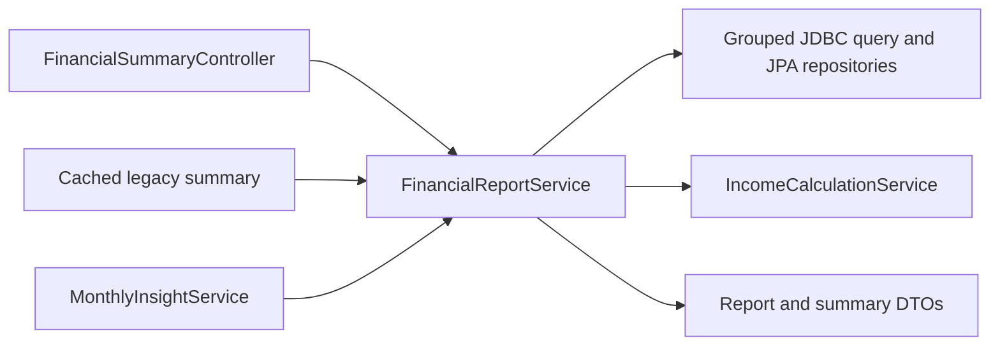
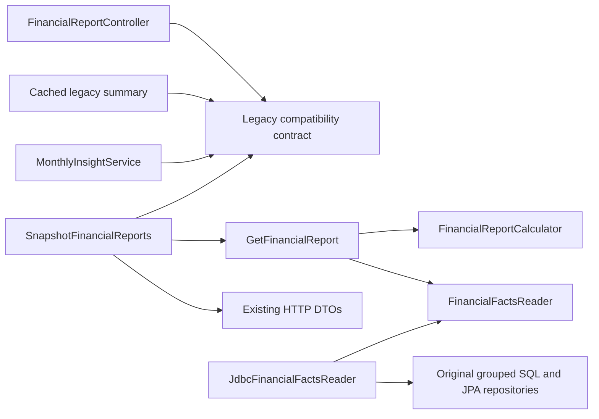

# Authoritative financial report read

Increment 4 covers authenticated `GET /api/financial-summary/report`. The report requires a valid year and a zero-based month. The legacy summary retains its existing UTC default-period handling and uses its own Redis cache. Monthly insights keep the existing consent lock and provider-call transaction.

## Dependency change

Before

After

Spring wires the reader, calculator and UTC system clock. The operation resolves the authenticated owner, validates the period, reads the clock once, and loads the facts. Both standalone and already-resolved entry points use the same calculator. The legacy contract retains transport and entity types at the outer boundary so existing callers require no changes. Its percentage helper delegates to the calculator. Remove the compatibility contract as its remaining callers migrate.

The infrastructure bean starts or joins a read-only `REPEATABLE_READ` transaction with the existing required propagation. For the standalone operation this includes owner resolution and all period reads. The call from insights joins the caller's transaction. A PostgreSQL test pauses after the current-period aggregation, commits current and previous expense changes and an income change on another connection, and checks the report still sees its original snapshot. Another test flushes an uncommitted manual transaction in the caller, verifies `facts` can see it while the caller remains writable, then rolls back and verifies that it disappears from a standalone report.

## Financial and persistence parity

The calculator carries over `money`, `round`, `allocate`, `reconcile` and `percentage`. It keeps stable residual tie ordering, including the distinction between rounding a negative half cent toward positive infinity and ordinary half-up rounding. The same PostgreSQL characterization suite covers the wire envelope and array order, nullable fields, invalid and unauthenticated requests, UTC month boundaries, leap years, year transitions, expected income, isolation, signed credits, transfers, zero-value rows, empty months and complete totals independently of transaction pagination.

PostgreSQL statement logs recorded six report data queries before and after: owner, current grouped aggregate, two versioned income lookups, budgets, previous grouped aggregate. They ran in that order on the same read-only transaction. HTTP authentication's separate session-version query is outside this count. The adapter preserves SQL, owner criteria and budget date ordering and maps only scalar fields. No wall-clock benchmark was performed. Avoid consolidating even the duplicate income lookup in this migration so its query behavior can be compared directly.

The authoritative route remains uncached. The legacy response classes and summary cache key, TTL and invalidation remain in their existing locations. ArchUnit applies the same rules to the new reporting packages. Two legacy helper classes and 36 obsolete exceptions were removed. The compatibility interface and its nested result remain in the legacy inventory. No exception was added.

## Rollback and next scope

Revert the reporting commits together, including the registry and ledger changes. There is no database or cache migration to undo.

The next bounded roadmap slice is the authenticated income/profile read. Start with the existing read endpoint and its expected-versus-actual income semantics, owner scoping and period defaults. Keep account setup and income writes separate until their validation and transaction requirements are characterized. The reporting calculator and reporting adapter remain private to reporting.

## Verification results

Java 17 clean verify recorded 826 passes, zero failures or errors and five pre-existing skips. The same ten report integration tests passed before and after, including the concurrent writer and the caller's write transaction. Three new plain tests cover one clock read, rejection boundaries, leap-day handling and calculation parity. PostgreSQL and Redis were disposable local instances. All seven healthy Redis cases and the Redis-unavailable case passed. The backend total includes 26 architecture checks. Client reporting checks passed 31 tests and TypeScript passed. [Baseline and scope](clean-architecture-baseline-2026-11-17.md)

Comparing the source bodies without formatting changes confirmed identical `money`, `round`, `allocate`, `reconcile` and `percentage` implementations. The grouped query matched after whitespace normalization.
