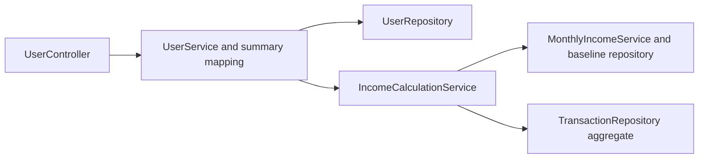
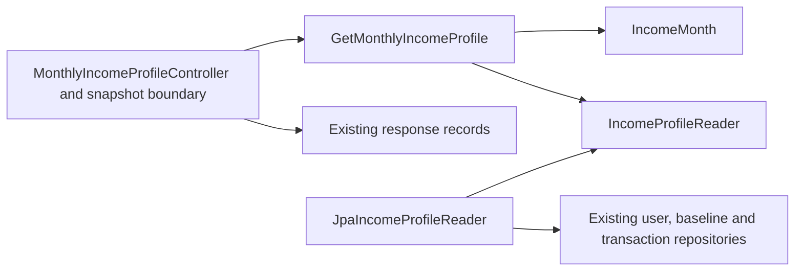

# Monthly-income profile read

Increment 5 moves authenticated `GET /api/users/me/monthly-income` into the `incomeprofile` feature. The profile hook passes the selected zero-based month and year through `UserAPI.getMonthlyIncome`. The response still uses the existing `UserDataResponse` envelope and `UserSummaryResponse` fields.

## Source dependencies

Before

After

The outer controller binds the principal and HTTP parameters, starts or joins a read-only repeatable-read transaction using required propagation, and maps the result to the existing response. The use case accepts a plain owner ID. It resolves that owner before validating the supplied values because the original path returns the missing-owner result first. It uses a validated `IncomeMonth` for the subsequent facts reads. The adapter maps scalar profile fields and uses the original repository queries.

The domain period builds half-open UTC windows. The application uses zero for an absent baseline and retains explicit zero. It returns expected and actual amounts separately, without rounding or selecting an effective reporting income. The baseline query selects the latest month at or before the request. The actual-income query aggregates the owner's non-transfer income transactions in the database. Other features keep their existing shared income services and report policy.

## Compatibility and verification

The original HTTP behavior includes 500 with the generic error message when Spring rejects an omitted required parameter. Supplied invalid values return 400 with the existing month/year message. Characterization also covers revoked sessions for deleted owners, the exact profile fields and nullable image, zero and missing baselines, carry-forward, future entries, leap February, December-to-January rollover, owner isolation, transfer exclusion and income precision. The use-case unit tests independently verify missing owner handling and read order.

The migration removes the legacy controller entry and its corresponding service method and parser. Nine obsolete ledger rows were removed. Legacy user, auth, setup and write paths keep their existing services, repository calls, locks and cache invalidation. No database or frontend change is required.

Rollback reverts the increment commits together, including the migration registry. The next bounded candidate is account-setup completion, after characterizing idempotency and owner-lock ordering. Its income and currency writes should be evaluated as part of that single transaction without migrating the standalone update routes.

PostgreSQL statement logs captured five successful fixture requests on each version. Each made three data queries in order: owner profile, latest eligible income baseline, and aggregate. Each sequence ran on one read-only repeatable-read transaction, with no explicit row lock or write. The separate JWT session-version lookup adds one read. The migration adds no query or dependency.
