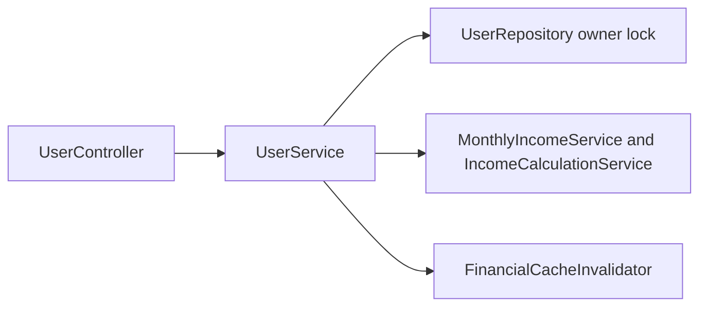
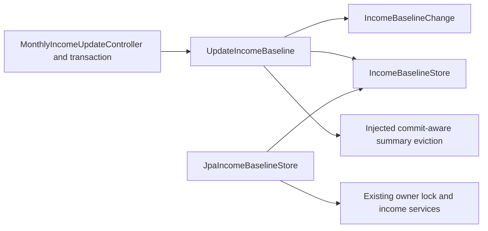

# Standalone monthly-income update

Increment 7 covers authenticated `PATCH /api/users/me/monthly-income`. The existing request and response records remain at the HTTP boundary. The profile client continues to send the selected zero-based month and year and to consume the same updated user summary.

## Dependencies

Before

After

Bean validation still precedes the transaction. The transaction takes the owner lock before applying the remaining input checks. The plain policy preserves the amount and period validation order and converts the selected month to `YearMonth`. The persistence adapter delegates to the existing monthly-income upsert, which reacquires the owner lock on the same transaction, finds the baseline by user and UTC month start, and updates or inserts it. It uses the existing expected and actual income calculations to return the selected period. The application registers summary eviction between the write and profile read. The original invalidator defers owner-wide summary eviction until commit.

The use case does not depend on private account-setup or income-profile code. Shared income services, repository queries, cache keys, serialization, schema, and frontend code stay in place. The legacy controller and service methods were removed with 12 obsolete dependency entries.

## Characterization

The same HTTP cases cover authenticated owner scoping, deleted accounts, validation precedence, exact response fields, leap February, December-to-January rollover, insert and update, and independent actual income. January carries forward into February until February has its own baseline, an earlier update leaves the later baseline in force, explicit zero carries forward, and a future baseline does not affect earlier months.

The original route accepts an overflowing positive numeric literal such as `1e1000`, persists positive infinity, and serializes it as the string `"Infinity"`. Characterization preserves this existing behavior. A separately approved validation change should reject nonfinite updates and assess any stored nonfinite baselines, which can cause downstream report rounding to fail.

PostgreSQL observes the second update waiting for the owner row, then sees a single baseline updated in commit order. Separate concurrency cases exercise both commit orders with the standalone currency writer through the HTTP income route. The Redis case verifies deferred region-wide eviction, rollback preservation, unaffected other-user and recurring-payment entries, successful commit through a controlled timeout, and eviction after recovery.

Roll back by reverting the increment commits together. No schema or cache conversion is required. The next bounded candidate is the standalone currency update. Characterize its response validation and rollback behavior, and preserve owner-lock serialization and both of its existing cache invalidation paths.

PostgreSQL recorded six endpoint statements each for the first insert and subsequent update, before and after. Each sequence includes two owner-lock reads, the exact-month lookup, one write, the carry-forward lookup, and the actual-income aggregate. Counts exclude JWT session lookup, transaction control and test observer queries.

The registry marks only this endpoint complete. The [hosted architecture workflow](https://github.com/Jatti045/fintech-platform/actions/runs/44967212874) passed on the implementation before the completion entry was updated.

## Increment 7.1 correction

The separate correctness repair rejects nonfinite amounts at the update and shared upsert boundaries. See the [validation and historical-data diagnostic](nonfinite-monthly-income.md). The characterization above records the behavior before that repair.
