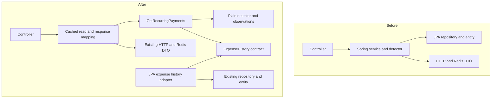

# Increment 2 recurring-payment read pilot

November 19, 2026. The architecture workflow succeeded on the exact starting dev revision `d6bdb735b351ce3b6ede1eb9294262abfb4ad688`. [GitHub Actions run](https://github.com/Jatti045/fintech-platform/actions/runs/44663008034)

Scope is authenticated `GET /api/recurring-payments`. Source dependencies before and after:

The composition root supplies the history adapter, detector, and UTC clock. The use case reads the clock once and calls the existing owner/type-scoped query with its inclusive 365-day cutoff and ascending date order. No transaction annotations or database changes were introduced. The one repository call on a cache miss is verified with a fixed leap-day clock and mock. The existing PostgreSQL integration tests exercise query results and ownership. The adapter makes one pass to copy scalar fields into observations, with no new lookup or traversal of relations. Wall-clock performance was not benchmarked.

The detector retains the cadence, UTC projection, merchant/series identity, price-change rules, ordering, confidence, and filtering. Existing response records and their serialized class names stay in place because they are also the Redis value types. The cached read maps only the resulting series and retains the ArrayList representation of the cached series and matched rows. It uses the same cache name and user ID key, retaining the configured 15-minute TTL, existing after-commit invalidation, and outage handling. The existing JWT filter still protects the endpoint. The UI continues consuming the same success envelope and ordered results.

The original workflow passed 27 targeted tests after adding the strict empty-response envelope assertion. An isolated checkout of that workflow then passed all seven HTTP cases including the strict two-series response and unauthorized envelope assertions. The fixture pins uppercase merchant keys, nullable fields, predicted-date ordering, and oldest-first matches. Existing tests cover unauthorized requests, owner isolation, monthly detection, date projections, price changes, refunds, transfers, and dormant series. The original detector assertions now exercise the plain detector, and two new use-case tests pin the leap-day cutoff, single repository call, and missing-actor failure before any query.

ArchUnit checks the new packages with the existing strict rules. The pilot removed three legacy binary class entries, including the detector's nested cadence record, and 17 obsolete dependency exceptions. No exceptions were added. The registry stays `partial` until healthy Redis verifies cache hits, serialization, and invalidation. Docker was unavailable and neither a Redis nor a Valkey server executable was installed in the inspected local tools. The outage path was exercised. Native device checks are outside this backend read pilot.

The same structure is suitable for other small read workflows if there is a meaningful pure policy and a narrow persistence contract. Keep existing serialized DTOs at the outer boundary where cache compatibility requires them. Evaluate reporting snapshot and transaction requirements independently before adopting this wiring for a more complex workflow.

Production files are under `fintech-api/src/main/java/com/fintechapp/fintech_api/recurring/`:

- `domain/ExpenseObservation.java`, `domain/RecurringPayment.java`, `domain/RecurringPaymentDetector.java`, and `domain/repositories/ExpenseHistory.java` hold framework-free data, policy, and the history contract.
- `application/GetRecurringPayments.java` coordinates the read, with a concrete use case because no interchangeable input implementation is needed.
- `adapters/persistence/JpaExpenseHistory.java` maps the existing query results.
- `infrastructure/web/RecurringPaymentController.java` replaces the old controller in its new package. `infrastructure/cache/CachedRecurringPayments.java` replaces the Spring service's caching and response mapping. `infrastructure/configuration/RecurringPaymentsConfiguration.java` wires the feature.

Tests changed in `RecurringPaymentIntegrationTest.java` and `RecurringPaymentServiceTest.java`, with `RecurringPaymentReadTest.java` added. The three architecture resources `legacy-classes.tsv`, `legacy-violations.txt`, and `migration-status.tsv` track the resolved exceptions and pending cache gate.

Java 17 `clean verify` completed with 813 passed, zero failed or errored, and 11 existing skips. The total includes 26 architecture tests and four tests added by the pilot. Compilation and executable packaging passed. Formatting and applicable pre-commit hooks passed.
