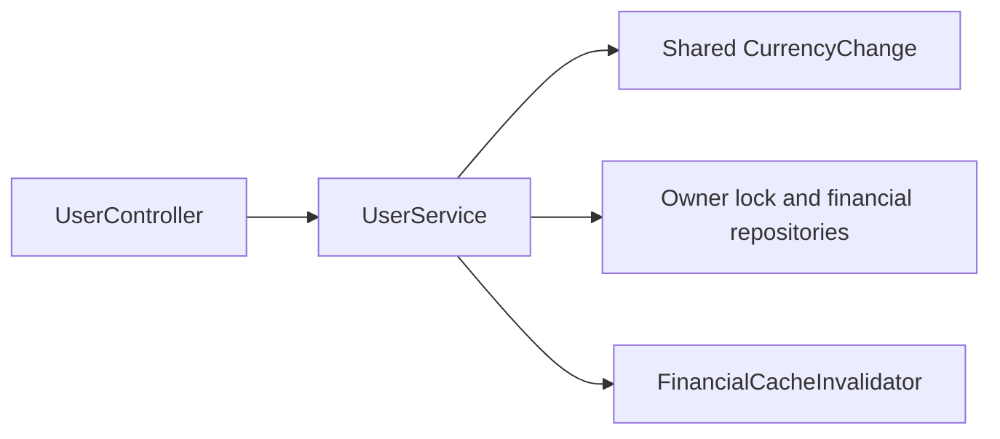
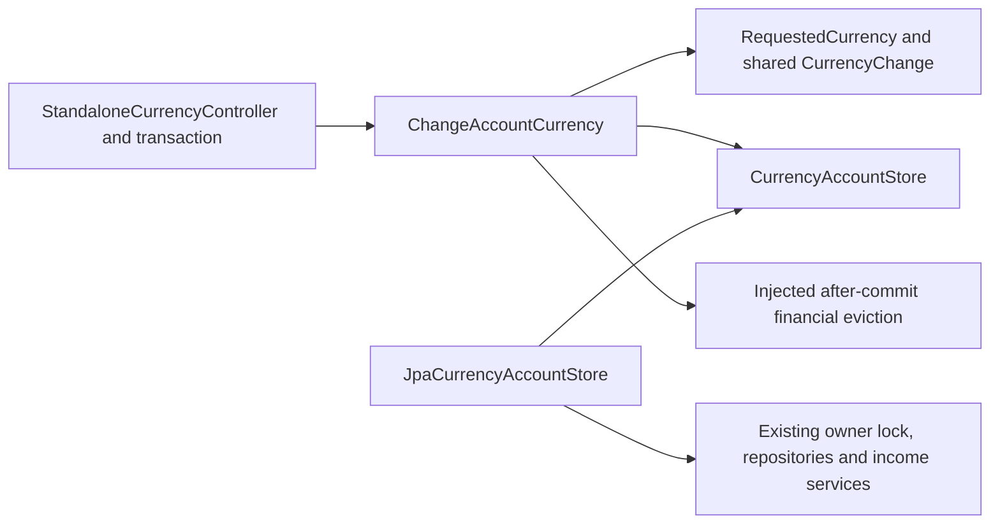

# Standalone currency update

Increment 8 covers authenticated `PATCH /api/users/me/currency`. The original request and response records remain at the HTTP boundary. The standalone route still accepts any three ASCII letters and normalizes case. For example, `xyz` becomes `XYZ`. Bean Validation rejects space-padded codes before service-level normalization. Account setup has its own ISO membership check. Tightening standalone validation would require a separate compatibility decision.

## Dependencies

Before

After

The transaction starts after MVC validation. The operation takes the owner lock before validating the code and comparing the current currency. The shared policy skips financial-data reads on a no-op. For a change, the adapter checks transactions, budgets and income in that order, stopping after the first match. The allowed path modifies the managed user and explicitly saves it, then registers both cache evictions and reads the current UTC month's profile. The adapter retains the existing income calculations and maps the saved managed entity. Existing dirty checking, row versioning, JWT and protected fields stay in place.

## Verification

The same original and migrated PostgreSQL cases exercise the HTTP envelope, authentication, deleted accounts, three-letter acceptance, eligibility, the no-op version, and successful version increment with preserved credential and session fields. PostgreSQL observes the waiting session for setup versus currency in both orders and for competing currency changes. Existing writer tests also exercise both commit orders for income, transactions and budgets and preserve coverage of profile and credential concurrency. The Redis tests verify no-op, blocked and rolled-back changes preserve both owner regions. Committed changes evict the owner's entries, a controlled timeout leaves the database commit intact, and eviction resumes after recovery.

Roll back by reverting the increment commits together. No database or cache conversion is required. The next bounded candidate is transaction categorization policy, starting with characterization of deterministic rule precedence independently of the transaction write workflow.

PostgreSQL statement counts matched before and after. Counts exclude JWT, transaction control and test-observer statements.

| Fixture | Before | After |
|---|---:|---:|
| Same currency | 3 | 3 |
| Successful change | 7 | 7 |
| Blocked by transactions | 2 | 2 |
| Blocked by budgets | 3 | 3 |
| Blocked by income | 4 | 4 |
| Two concurrent successful currency requests | 7 + 7 | 7 + 7 |
| Currency commits, then setup | 7 + 11 | 7 + 11 |
| Setup commits, then currency is blocked | 11 + 4 | 11 + 4 |

Each measured currency request used one `FOR NO KEY UPDATE` read. A successful change used one version-checked write. The blocked paths and same-currency requests made zero writes. Existing JPA auto-flush and response calculation order are preserved.

The registry marks only this endpoint complete. The [hosted architecture check](https://github.com/Jatti045/fintech-platform/actions/runs/44969378787) passed before the completion entry was updated.
